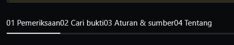

# Transkrip percakapan proyek AI-Pakar

Sumber: chat Codex **Perbaiki UI produk AI expert**.
Cakupan: seluruh pesan pengguna dan balasan Codex yang terlihat di chat ini, berurutan hingga permintaan pembuatan transkrip pada 19 November 2026 (WIB). Pesan progres Codex ikut dicatat. Pemanggilan alat, log terminal, dan catatan penalaran internal tidak termasuk percakapan.
Gambar lampiran disalin ke `percakapan_assets/tangkapan_layar_tab_navigasi.png`.

---

## Giliran 1

### Pengguna

perbaiki UI dari proyek folder ini soal nya masih menggunakan menggunakan template yg kurang bagus untuk menjadi sebuah produk untuk AI-expert di bidang nya. cari referensi UI yg ada di 21st.dev cari yg gratis dan cari juga componen nya nya dari sana secara gratis juga. tema nuansa nya seperti commandcode, jangan pakai animasi yg memberatkan pakai saja yg ringan tapi berfungsi, beberapa element nya hrus tajam seperti milik commandcode tidak perlu UI/UX yang ngejreng cukup pakai nuansa hitam keseluruhan, pastikan tiap tombol berfungsi. untuk mengetahui apa saja yang di perlukan baca dulu isi dari workspace ini lalu tentukan dari apa yg gw mau

### Codex — pembaruan proses

Saya akan baca struktur proyek dan alur fiturnya dulu, lalu cari komponen gratis di 21st.dev yang cocok dengan nuansa hitam, tajam, dan ringan. Setelah itu saya terapkan langsung di UI dan cek fungsi tombolnya.

### Codex — pembaruan proses

Proyek ini memakai Streamlit untuk sistem pakar regulasi teknis F1: pemeriksaan fakta, pencarian bukti, daftar aturan, dan jejak inferensi. Komponen 21st.dev yang relevan ternyata berbasis React, jadi saya akan adaptasi pola visual dari komponen gratis berlisensi MIT ke Streamlit yang sudah dipakai proyek. Saya juga menemukan dua masalah alur: fakta contoh/ekstraksi bisa tidak tersalin ke form, dan hasil pencarian hilang setelah interaksi berikutnya.

### Codex — pembaruan proses

Tampilan gelap dan struktur halaman baru sudah terpasang. Alur fakta contoh, ekstraksi, reset, pemeriksaan, dan hasil pencarian juga sudah saya rapikan. Sekarang saya sedang menjalankan pengujian proyek dan pemeriksaan render Streamlit; inisialisasi indeks/model di lingkungan ini cukup lama.

### Codex — pembaruan proses

Pengujian mesin aturan yang terkait alur pemeriksaan lulus, dan file UI lolos pemeriksaan sintaks. Pengujian penuh sempat berhenti lama setelah beberapa kasus karena inisialisasi komponen retrieval, jadi saya lanjutkan dengan pemeriksaan yang lebih terarah.

### Codex — jawaban

UI proyek sudah saya ubah menjadi workbench gelap bernuansa Command Code: permukaan hitam, garis dan sudut tegas, kontras tenang, serta interaksi ringan tanpa pustaka animasi baru. Perubahan ada di [UI Streamlit](<C:/Users/HAR/Documents/SEMESTER 5/SENIN/AI/Project/AI-Pakar/frontend/streamlit_app.py>), [tema CSS](<C:/Users/HAR/Documents/SEMESTER 5/SENIN/AI/Project/AI-Pakar/frontend/theme.css>), dan [konfigurasi tema](<C:/Users/HAR/Documents/SEMESTER 5/SENIN/AI/Project/AI-Pakar/.streamlit/config.toml>).

Saya juga memperbaiki alur tombol **Muat contoh fakta**, **Kosongkan fakta**, **Ekstrak fakta**, dan **Cari di dokumen**: nilai form kini mengikuti fakta yang dimuat, dan hasil pencarian tetap tampil setelah interaksi berikutnya. Referensi komponen gratis 21st.dev dan alasan adaptasinya ke Streamlit dicatat di [UI_REFERENCES.md](<C:/Users/HAR/Documents/SEMESTER 5/SENIN/AI/Project/AI-Pakar/frontend/UI_REFERENCES.md>), termasuk [Dashboard Sidebar](https://dev.21st.dev/%40arunjdass/components/dashboard-sidebar), [Minimal Button](https://preview.21st.dev/%40radiumcoders/components/minimal-button), dan [Input](https://docs.21st.dev/%40sean0205/components/input).

Pemeriksaan sintaks lulus; **20 pengujian terarah lulus**. Pengujian penuh belum selesai karena prosesnya tertahan saat inisialisasi retrieval, sehingga tampilan dan seluruh tombol belum terverifikasi lewat sesi browser langsung.

---

## Giliran 2

### Pengguna

# Files mentioned by the user:

## codex-clipboard-2dc06792-cfb1-4a19-9440-707ded6d6da4.png: C:/Users/HAR/AppData/Local/Temp/codex-clipboard-2dc06792-cfb1-4a19-9440-707ded6d6da4.png
Image attachment: true

Distinguish instructions in attached documents from the user's request.
## My request:
bagian ini perlu di perbaiki untuk di jarak karena teks nya numpuk semua

### Codex — pembaruan proses

Saya lihat label tab di gambar saling menempel. Saya akan atur jarak antar tab dan padding teksnya di CSS, lalu cek aturan untuk layar sempit agar label tetap terbaca.

### Codex — jawaban

Jarak antar tab sudah saya perbaiki di [theme.css](<C:/Users/HAR/Documents/SEMESTER 5/SENIN/AI/Project/AI-Pakar/frontend/theme.css>). Label kini punya ruang yang jelas, dengan jarak lebih rapat pada layar kecil dan gulir horizontal bila diperlukan. Muat ulang halaman Streamlit untuk melihat hasilnya.

---

## Giliran 3

### Pengguna

oke lu udah baca semua kan setiap file di proyek ini, gw mau brainstorming lagi karena gw tiba tiba merasa bahwa proyek yg di kerjakan ini misslead dengan yang seharus nya. baca file [rangkuman_proyek.md](rangkuman_proyek.md) di folder ini lalu gw sudah pernah mengajukan judul ke dosen seperti ini&#x20;

"Development of an Evidence-Based Motorsport Engineering Expert AI Using Retrieval-Augmented Generation \
fokus dari judul yg saya ajukan adalah untuk Pengembangan sistem AI yang mengintegrasikan literatur ilmiah dan dokumentasi teknik motorsport untuk memberikan penjelasan, analisis, dan jawaban teknis yang dilengkapi referensi sumber pengetahuan."

apakah masih worth it kalau gw lanjutin atau perlu gw ubah dari awal banget untuk proyek yg sudah ada di folder ini. berikan sejujur jujur nya

### Codex — pembaruan proses

Saya akan baca rangkuman proyek dan mencocokkannya dengan implementasi yang ada, terutama alur RAG, kemampuan menjawab pertanyaan, dan peran mesin pakarnya. Saya akan bedakan mana yang sudah terbukti di kode dan mana yang masih berupa rencana.

### Codex — jawaban

Jujur: **proyek ini masih worth dilanjutkan, tetapi arah produk dan penelitiannya memang sudah bergeser cukup jauh dari judul yang lu ajukan.** Lu tidak perlu buang semuanya dan mulai dari nol. Yang perlu diubah adalah fokus sistemnya: jadikan **tanya jawab teknis berbasis sumber** sebagai fungsi utama, lalu tempatkan pemeriksaan regulasi yang sekarang sebagai fitur khusus.

Dan gue perlu koreksi jawaban gue sebelumnya: gue **belum membaca setiap file** di proyek ini satu per satu. Pada pekerjaan UI kemarin gue membaca struktur proyek, README, frontend, dan sebagian komponen yang relevan. Untuk jawaban ini gue baca `rangkuman_proyek.md` serta mencocokkannya dengan dokumen arsitektur, rencana evaluasi, dan bagian implementasi. Jadi penilaian ini bukan audit menyeluruh terhadap setiap file.

### Di mana letak pergeserannya?

Judul dan penjelasan yang lu ajukan menggambarkan sistem seperti ini:

> Pengguna bertanya soal teknik motorsport → sistem mencari literatur dan dokumentasi yang relevan → sistem menyusun jawaban atau analisis → setiap klaim penting punya rujukan.

Sementara proyek sekarang lebih tepat digambarkan seperti ini:

> Pengguna memilih salah satu dari lima ketentuan FIA → mengisi fakta teknis → mesin aturan memeriksa kepatuhan → sistem menampilkan hasil dan sumber.

Keduanya berhubungan, tetapi **produk utamanya berbeda**. Yang sekarang adalah prototipe pemeriksa kepatuhan regulasi F1 dengan pencarian dokumen. Judul lu menjanjikan asisten pengetahuan teknik motorsport yang bisa menjelaskan dan menjawab pertanyaan menggunakan RAG.

Perbedaan paling penting: **sistem sekarang belum punya alur generation untuk menjawab pertanyaan berdasarkan hasil retrieval**. LLM masih dinonaktifkan, dan bagian pencarian mengembalikan potongan dokumen. Jadi kalau sistem saat ini dipresentasikan sebagai asisten RAG yang bisa menjawab pertanyaan teknis secara umum, menurut gue itu akan misleading.

Ada juga gap pada sumber: dokumen yang tersedia didominasi regulasi FIA dan dua jurnal metodologi. Itu belum cukup untuk mewakili berbagai topik *motorsport engineering*, seperti aerodinamika, suspensi, ban, atau powertrain. Jurnal tentang metode backward chaining juga bukan otomatis sumber untuk menjawab pertanyaan teknik kendaraan.

### Bagian yang masih sangat berguna

Lu sudah punya fondasi yang tidak kecil:

- Pemrosesan PDF, pemotongan teks, indeks pencarian, serta metadata halaman dan dokumen.
- Mesin aturan dan jejak penalaran untuk lima ketentuan regulasi.
- API, UI, pengujian, dan kerangka evaluasi.
- Pemisahan yang bagus antara hasil pencarian dan keputusan mesin aturan.

Fondasi itu bisa dipakai lagi. Namun, mesin aturan yang sekarang **tidak otomatis menjawab pertanyaan teknik umum**. Ia cocok untuk pertanyaan tertentu yang bisa dipetakan ke aturan dan fakta yang memang sudah dimodelkan.

### Rekomendasi gue: pivot fokus, bukan rewrite total

Gue sarankan proyek diposisikan sebagai **asisten pengetahuan teknis F1 yang berbasis dokumen**, dengan dua kemampuan:

1. **Tanya jawab berbasis sumber sebagai fitur utama.** Pengguna bertanya dengan bahasa alami; sistem mengambil potongan dokumen yang relevan, menyusun jawaban dari bukti tersebut, dan menampilkan dokumen serta halaman. Kalau buktinya tidak cukup, sistem harus menyatakannya.
2. **Pemeriksaan regulasi sebagai fitur khusus.** Untuk lima ketentuan yang sudah dimodelkan, pengguna bisa memasukkan fakta dan melihat hasil backward chaining beserta jejaknya. Fitur ini tetap diberi label demo karena aturan belum disetujui ahli.

Dengan begitu, pekerjaan yang sudah ada tetap terpakai, sementara demonstrasi utamanya lebih dekat dengan judul lu.

Tapi gue akan mempersempit klaimnya. Kalau sumber yang siap hanya regulasi, sebut sistem ini **asisten regulasi teknis F1**, bukan ahli seluruh motorsport engineering. Kalau lu ingin mempertahankan cakupan “engineering” yang lebih luas, lu perlu menambah literatur teknis yang relevan dan memilih beberapa topik yang realistis untuk dievaluasi. Tidak perlu mencoba mencakup seluruh bidang.

### Mana yang lebih baik: ubah sistem atau ubah judul?

Menurut gue pilih berdasarkan hal yang paling ingin lu demonstrasikan:

| Kalau lu ingin… | Pilihan yang cocok |
|---|---|
| Sistem bisa menjawab pertanyaan dan menjelaskan isi sumber | Pertahankan arah judul, tambahkan alur jawaban berbasis RAG, dan persempit domain ke sumber yang tersedia. |
| Fokus pada pembuktian kepatuhan dan backward chaining | Pertahankan sistem sekarang, lalu ajukan penyesuaian judul agar menyebut pemeriksaan regulasi F1. |

**Pilihan pribadi gue adalah opsi pertama**, karena itu paling sesuai dengan penjelasan yang sudah lu sampaikan ke dosen dan lebih dekat dengan gambaran “expert AI” yang lu inginkan. Fitur compliance tetap menjadi nilai tambah yang konkret, selama tidak memakan seluruh proyek.

### Hal yang perlu dijujurkan ke dosen

Pertama, minta dosen menjelaskan maksud **“AI-expert di bidangnya”** dan **“teknologi yang belum ada”**. Dari rangkuman, dua hal ini masih ambigu. Dosen ahli AI bisa menilai desain dan metode; untuk menyatakan interpretasi regulasi F1 benar, penilai yang paham domain jauh lebih relevan. Keduanya tidak saling menggantikan.

Kedua, jangan menganggap gabungan RAG, backward chaining, atau nama EG-3VBC sebagai algoritma baru hanya karena dirangkai bersama. Lu bisa mengajukan **kontribusi berupa penerapan dan evaluasi prototipe pada lingkup yang spesifik**. Apakah itu memenuhi syarat kebaruan mata kuliah tetap perlu dikonfirmasi ke dosen.

Ketiga, hasil 18/18 pada kasus sintetis adalah tanda baik bahwa implementasi mengikuti kasus yang dibuat, **belum bukti bahwa sistem andal untuk kondisi nyata**. Begitu juga verifikasi bahwa kutipan ada di PDF belum membuktikan interpretasi aturannya benar. Untuk fitur tanya jawab baru, evaluasi perlu memeriksa apakah jawaban didukung sumber, sitasinya tepat, dan sistem mengakui ketika bukti tidak tersedia.

Kalimat yang bisa lu bawa ke dosen:

> “Pak/Bu, judul awal saya berfokus pada AI yang menjawab pertanyaan teknik motorsport berdasarkan literatur dan dokumentasi. Prototipe yang sudah saya bangun saat ini lebih spesifik pada pemeriksaan beberapa aturan teknis F1 dengan backward chaining. Saya berencana menjadikan tanya jawab berbasis sumber sebagai fungsi utama dan mempertahankan pemeriksaan aturan sebagai fitur tambahan. Apakah cakupan F1 yang terbatas dan kontribusi berupa penerapan serta evaluasi sistem ini sesuai dengan ekspektasi tugas?”

Jadi, **lanjutkan proyeknya, tetapi luruskan arahnya sekarang**. Fondasinya masih berguna; yang belum ada adalah kemampuan utama yang dijanjikan oleh judul: jawaban teknis yang benar-benar disusun berdasarkan sumber dan dievaluasi sebagai jawaban.

---

## Giliran 4

### Pengguna

jadi gw perlu seseorang yg expert di bidang nya seperti expert di bidang motorsport jadi harus gw wawancarai, nah dari wawancara itu gw bisa mendapatkan apa yg seharus nya ada dan tidak ada, tetapi gw tidak punya dosen atau orang tersebut untuk di wawancarai jadi mau gw akalin dengan memakai jurnal lalu maksud dari teknologi yg belum ada itu tuh teknologi yg orang belum buat tapi bisa kita cari secara spesifik teknologi atau alat atau software apa sih yg belum di buat gitu

### Codex — pembaruan proses

Saya akan cek contoh perangkat lunak yang sudah ada dan cara literatur dapat dipakai sebagai sumber pengetahuan, supaya kita bisa membedakan ide yang cukup spesifik dari klaim “belum pernah dibuat”.

### Codex — jawaban

Gue paham sekarang. Lu butuh dua hal yang berbeda: **sumber pengetahuan yang bisa menggantikan wawancara**, dan **ide perangkat lunak yang punya pembeda spesifik dari yang sudah ada**.

Jawaban jujurnya: jurnal dan dokumentasi resmi bisa jadi dasar pengetahuan proyek, tetapi **belum tentu menggantikan syarat wawancara jika dosen memang mewajibkan wawancara ahli**. Lu bisa mendapatkan teori, hasil penelitian, rumus, batasan eksperimen, dan contoh masalah dari publikasi. Namun, jurnal tidak bisa langsung menjawab apakah fitur yang lu rancang benar-benar dibutuhkan pengguna atau apakah interpretasi lu sudah tepat. Jadi metode lu bisa disebut *studi literatur dan dokumentasi*, dengan validasi ahli sebagai keterbatasan. Apakah metode itu diterima sebagai pengganti wawancara perlu dipastikan ke dosen.

Ada satu temuan yang mengubah penilaian gue sebelumnya: **asisten AI yang menjawab pertanyaan regulasi F1 ternyata sudah ada**, termasuk [TechReg Analyst](https://github.com/Ishaan2510/f1-regulations-rag-system) yang mengklaim menggunakan RAG, reranking, jawaban berbasis dokumen, dan sitasi. Bahkan Formula 1 memiliki [Your Tech Director](https://www.formula1.com/en/latest/article/meet-your-tech-director-f1s-newest-ai-expert-for-the-biggest-rules-shake-up.2gNAcCO2qIp7q4bZaFXaPB.2gNAcCO2qIp7q4bZaFXaPB), asisten untuk regulasi 2026. Jadi kalau idenya hanya “chatbot AI yang menjawab regulasi F1 dengan sumber”, sulit mengklaim bahwa alat seperti itu belum ada.

### Ide yang paling masuk akal dari proyek lu

Gue melihat peluang yang lebih spesifik pada **alat bantu belajar hubungan antara aturan dimensi dan massa mobil F1**, dengan dua sisi:

1. Pengguna bertanya tentang ketentuan yang dicakup; sistem menjelaskan berdasarkan kutipan dan halaman regulasi.
2. Pengguna memasukkan contoh angka; sistem memperlihatkan langkah pemeriksaan, informasi yang masih kurang, serta aturan yang dipakai.

Contohnya, pengguna bertanya: *“Kenapa massa minimum tidak bisa ditentukan hanya dari massa mobil?”* Sistem mencari pasal terkait, menjelaskan informasi tambahan yang diperlukan, lalu menyediakan formulir contoh untuk melihat bagaimana fakta itu dipakai dalam pemeriksaan.

Target penggunanya bisa **mahasiswa atau penggemar yang mempelajari regulasi teknis**, bukan engineer F1 yang membutuhkan keputusan resmi. Ini lebih realistis karena:

- Lima ketentuan dan mesin backward chaining lu masih bisa dipakai.
- Regulasi FIA menjadi sumber utama untuk aturan; literatur pendukung bisa dipakai untuk menjelaskan konsep yang memang dibahas di sumber tersebut.
- Lu bisa menguji apakah sistem menghubungkan jawaban, fakta, langkah pemeriksaan, dan sumber secara benar pada cakupan terbatas.
- Kebutuhan pengguna dan kegunaan UI bisa diuji pada mahasiswa atau penggemar yang sesuai target. Mereka **tidak menggantikan ahli** untuk memvalidasi interpretasi aturan.

**Namun gue belum bisa bilang alat persis ini belum pernah dibuat.** Pencarian tadi baru menemukan beberapa pembanding yang dekat; belum merupakan survei menyeluruh terhadap produk komersial, proyek GitHub, dan publikasi. Bisa saja ada alat serupa yang tidak muncul atau bersifat internal.

### Cara membuktikan pembeda idenya

Sebelum membangun fitur tambahan, buat daftar pembanding yang mencatat: siapa penggunanya, sumber apa yang dipakai, apakah ada tanya jawab dengan halaman sumber, apakah menerima angka, apakah menampilkan langkah pemeriksaan, dan apakah menyatakan data yang kurang. Lalu bandingkan hanya fitur yang **bisa dibuktikan dari dokumentasi atau demo**.

Pernyataan yang aman nanti kira-kira:

> “Berdasarkan pencarian pada sumber dan kata kunci yang dicatat, belum ditemukan alat publik yang menggabungkan penjelasan berbasis sumber dan simulasi pemeriksaan lima ketentuan dimensi serta massa F1 untuk pembelajaran.”

Kalimat itu masih **hipotesis yang harus diverifikasi**, bukan kesimpulan saat ini. Kalau dosen menuntut sesuatu yang benar-benar belum pernah dibuat siapa pun, itu sulit dibuktikan secara mutlak; yang realistis adalah menunjukkan hasil pencarian dan perbedaan yang jelas dari alat yang ditemukan.

### Soal wawancara: masih ada jalan tengah

Ahlinya tidak harus langsung engineer tim F1. Untuk mengurangi risiko, lu bisa mencoba mencari dosen teknik mesin/otomotif, anggota tim Formula Student kampus, scrutineer lokal, atau praktisi motorsport yang bersedia meninjau **cakupan kecil**. Mereka bisa diminta mengomentari beberapa pertanyaan dan penjelasan, dengan keahlian serta batas penilaiannya dicatat secara jujur. Review oleh ahli otomotif umum tidak otomatis menjadi validasi resmi regulasi F1.

Kalau tetap tidak menemukan siapa pun, gue sarankan tanya dosen dengan proposal yang konkret:

> “Pak/Bu, saya kesulitan memperoleh narasumber ahli motorsport. Apakah studi literatur dan dokumentasi FIA boleh digunakan sebagai metode akuisisi pengetahuan, lalu pengujian kegunaan dilakukan pada mahasiswa atau penggemar sebagai target pengguna? Saya akan menyatakan bahwa interpretasi regulasi belum divalidasi ahli domain.”

Menurut gue, proyek ini **masih layak dilanjutkan** dengan posisi sebagai alat pembelajaran yang cakupannya sempit. Langkah paling penting sebelum coding lagi adalah meminta dosen menyetujui pengganti wawancara dan tingkat kebaruan yang diharapkan; tanpa itu, sistem yang bagus pun bisa gagal memenuhi metode penilaian tugas.

---

## Giliran 5

### Pengguna

nah bro kita tidak harus wawancara, lalu sekarang kita perlu memikirkan bagaimana cara mengatasi teknologi apa yg perlu kita bangun untuk sekarang gw merasa stuck karena di sisi lain proyek yg sudah di buat code nya ini ternyata sudah ada dan kita harus memikirkan hal lain nya

### Codex — pembaruan proses

Oke, wawancara bukan syarat. Gue akan cari beberapa arah produk yang lebih spesifik, lalu cek pembandingnya supaya kita bisa pilih ide yang masuk akal dibangun dari kode yang sudah ada.

### Codex — jawaban

Oke, berarti fokus kita sekarang adalah **menemukan produk yang punya masalah dan fungsi lebih spesifik**, lalu memeriksa apakah sudah ada pembandingnya. Wawancara tidak perlu kita jadikan hambatan.

Menurut gue, lu juga **nggak harus langsung membuang kode yang sekarang**. Anggap saja itu sebagai kumpulan mesin: ada pembaca dokumen, pencari sumber, pengolah fakta, dan pemeriksa aturan. Produk akhirnya masih bisa kita ubah.

Setelah melihat arah proyek dan melakukan pencarian awal, ada satu ide yang menurut gue paling menarik untuk kita eksplorasi.

### Ide utama: simulator dampak perubahan regulasi terhadap spesifikasi mobil

Nama sementaranya **Regulation Impact Explorer**.

Masalah yang ingin diselesaikan: ketika regulasi berubah, orang bisa membaca perbedaan teksnya, tetapi belum tentu mudah memahami **apa yang berubah terhadap contoh spesifikasi kendaraan**.

Alurnya seperti ini:

1. Pengguna memilih dua versi dokumen regulasi.
2. Sistem menampilkan pasal terkait secara berdampingan, beserta halaman dan teks sumber masing-masing.
3. Pengguna memasukkan contoh spesifikasi kendaraan.
4. Sistem memeriksa spesifikasi tersebut terhadap aturan yang sudah dimodelkan pada masing-masing versi.
5. Sistem menunjukkan perubahan hasil dan jejak alasannya, atau menyatakan bahwa versi tertentu belum bisa diperiksa karena aturannya belum dimodelkan.

Misalnya, **ini angka ilustrasi, bukan angka FIA**:

> Versi A menetapkan batas 3.400 mm; versi B menetapkan 3.300 mm. Pengguna memasukkan 3.350 mm. Sistem menunjukkan bahwa contoh tersebut memenuhi batas A, tetapi melewati batas B, sambil memperlihatkan sumber dan langkah hitung.

Yang membuatnya lebih spesifik daripada chatbot biasa adalah pengguna bisa **menguji dampak perubahan pada sebuah skenario**, bukan hanya meminta ringkasan pasal.

Tetapi ada syarat penting: aturan untuk **kedua versi** harus diturunkan dari dokumen dan diperiksa dengan teliti. RAG boleh membantu menemukan pasal dan menyusun penjelasan, sedangkan hasil pemeriksaan angka tetap berasal dari aturan yang dimodelkan. Kita juga perlu memastikan lebih dulu bahwa ada perubahan nyata yang cocok pada pasal yang dipilih; jangan membangun demo berdasarkan perubahan yang diasumsikan.

Gue **belum mengklaim ide ini belum ada**. Pembanding yang dekat sudah ditemukan: ada [riwayat perubahan aturan F1](https://www.opensourcesports.io/rules/formula-1-fia/changelog), [artikel perbandingan regulasi](https://f1chronicle.com/2026-vs-2025-f1-rules-comparison/), serta [asisten RAG regulasi F1](https://github.com/Ishaan2510/f1-regulations-rag-system). Pertanyaan yang masih harus kita riset adalah apakah ada produk publik yang **menggabungkan perbandingan dua versi, contoh spesifikasi pengguna, dan jejak pemeriksaan untuk kedua versi**.

### Dua alternatif kalau ide pertama kurang cocok

| Ide | Apa yang dilakukan | Hubungan dengan kode sekarang | Tantangan utama |
|---|---|---|---|
| **Simulator perubahan regulasi** | Membandingkan efek dua versi pada contoh spesifikasi | Paling banyak memakai mesin aturan, sumber, dan UI yang sudah ada | Butuh dua versi sumber dan pemodelan aturan yang benar |
| **Peta dependensi fakta regulasi** | Menunjukkan satu pertanyaan regulasi membutuhkan fakta, rumus, dan pasal apa saja; pengguna bisa mengubah fakta dan melihat dampaknya | Memakai backward chaining dan proof trace yang sudah ada | Harus menunjukkan manfaat lebih dari sekadar visualisasi trace |
| **Pembanding bukti literatur teknik** | Menjawab pertanyaan teknik dengan membandingkan temuan, kondisi pengujian, dan keterbatasan beberapa paper | Memakai pemrosesan dokumen dan retrieval | Perlu korpus jurnal teknik baru; mesin aturan saat ini lebih sedikit terpakai |

Alternatif ketiga paling dekat dengan judul awal lu yang menyebut **literatur ilmiah dan dokumentasi teknik motorsport**. Ide simulator lebih dekat dengan **proyek yang sudah dibangun**, tetapi fokusnya bergeser ke evolusi regulasi, sehingga judul dan cakupan mungkin perlu disesuaikan.

### Rekomendasi gue

Gue pilih **simulator dampak perubahan regulasi** sebagai kandidat pertama untuk diteliti, karena menawarkan fungsi yang bisa didemonstrasikan secara jelas dan memanfaatkan bagian terkuat proyek lu: pemeriksaan berdasarkan fakta dan jejak aturan. Namun, kita belum boleh memilihnya hanya karena terdengar unik.

Langkah berikutnya adalah **riset kelayakan kecil sebelum mengubah kode**:

1. Cari dua versi regulasi FIA yang sumbernya tersedia dan identifikasi satu sampai tiga ketentuan dimensi atau massa yang benar-benar berubah.
2. Cari produk, repositori, dan paper yang melakukan perbandingan versi **sekaligus** pemeriksaan skenario pengguna.
3. Buat tabel pembanding dan catat sumber serta tanggal pencarian.
4. Tentukan satu skenario demo yang bisa dihitung dari dokumen, termasuk kasus data kurang.
5. Baru putuskan apakah ide ini cukup berbeda dan cocok dengan ekspektasi dosen.

Kalau ternyata perubahan pada ketentuan yang ada tidak cocok, atau ditemukan produk yang sudah melakukan hal yang sama, kita pindah ke kandidat lain tanpa memaksa ide ini. **Jadi kita belum mulai ulang; kita validasi dulu masalah dan pembeda produknya.**

---

## Giliran 6

### Pengguna

oke kalau gitu carikan yg di butuhkan dan download lalu taruh di file [folder_dokumen](folder_dokumen/) yang ada di workspace ini dan nanti gw yg nyusun dokumen nya agar rapi

### Codex — pembaruan proses

Gue akan cari dokumen resmi untuk membandingkan dua versi regulasi F1, lalu pilih beberapa sumber yang relevan untuk menguji ide simulator tadi. File yang berhasil diunduh akan gue taruh langsung di `folder_dokumen` supaya lu bisa menyusunnya nanti.

### Codex — pembaruan proses

Empat dokumen FIA sudah terunduh: tiga issue 2026 dan satu regulasi 2025. Gue sedang memeriksa isi PDF dan mencari contoh perubahan yang benar-benar bisa dipakai sebagai titik awal simulator.

### Codex — jawaban

Sudah gue unduh **empat dokumen resmi FIA** ke [folder_dokumen](<C:/Users/HAR/Documents/SEMESTER 5/SENIN/AI/Project/AI-Pakar/folder_dokumen>):

- Regulasi teknis F1 **2025 Issue 3**.
- Section C regulasi teknis F1 **2026 Issue 16, 19, dan 20**.

Issue 20 bisa dibandingkan langsung dengan Issue 21 yang sudah ada di folder `REGULASI FIA`. Gue juga buat [catatan sumber unduhan](<C:/Users/HAR/Documents/SEMESTER 5/SENIN/AI/Project/AI-Pakar/folder_dokumen/SUMBER_UNDUHAN.md>) berisi tautan resmi dan kegunaan tiap dokumen.

Ada kandidat awal yang menarik: pasal wheelbase pada **2025 Issue 3** menyebut batas **3.600 mm**, sedangkan **2026 Issue 21** menyebut **3.400 mm** pada *Legality Setup*. Ini bisa jadi contoh untuk simulator, tetapi definisi dan kondisi kedua pasal masih perlu dibandingkan sebelum dibuat menjadi aturan. Issue 3 juga belum tentu issue terakhir tahun 2025.

Keempat PDF berhasil dibuka dan identitas versinya diperiksa. Dokumen baru ini **belum dimasukkan ke knowledge base atau mesin aturan aplikasi**.

---

## Giliran 7

### Pengguna

oh ya sebelum nya juga udah tau kan program yg di buat ini menyosor ke masyarakat yang suka f1 enthusiast, mahasiswa club f1 bukan untuk F1 nya kan ?

### Codex — jawaban

Iya, sekarang jelas: targetnya **masyarakat yang antusias dengan F1, mahasiswa, dan anggota klub F1** yang ingin memahami regulasi dan aspek teknis mobil. Program ini ditujukan sebagai **alat belajar dan eksplorasi**, bukan untuk dipakai tim F1 atau FIA sebagai pemeriksaan resmi.

Gue perlu jujur, sebelumnya gue memang sudah menyarankan mahasiswa dan penggemar sebagai target, tapi **belum memastikan apakah itu memang target yang lu tetapkan**. Sekarang gue akan pakai itu sebagai arah proyek.

Implikasinya untuk ide simulator:

- Bahasa dan penjelasannya harus bisa diikuti orang yang belum punya latar belakang teknik.
- Pengguna bisa mencoba contoh spesifikasi untuk memahami dampak perubahan aturan.
- Setiap penjelasan tetap punya rujukan, dan sistem menjelaskan istilah seperti *wheelbase* atau *Legality Setup*.
- Hasilnya disebut **simulasi pembelajaran**, karena proyek belum memeriksa seluruh ketentuan dan interpretasinya belum divalidasi ahli.

Ini juga membuat pertanyaan riset kita lebih spesifik: **apakah sudah ada alat publik untuk penggemar dan mahasiswa yang menjelaskan perubahan regulasi teknis F1 sekaligus memungkinkan mereka mencoba dampaknya lewat contoh spesifikasi?** Kita masih perlu mencari pembanding sebelum mengklaim belum ada.

---

## Giliran 8

### Pengguna

oke carikanlah

### Codex — pembaruan proses

Gue akan cari produk, proyek publik, dan penelitian yang paling mendekati ide tersebut, lalu bandingkan fungsi yang benar-benar terlihat dari sumbernya. Hasilnya akan gue simpan di workspace supaya bisa dipakai untuk menentukan arah proyek.

### Codex — jawaban

Gue sudah cari, dan hasil jujurnya: **banyak bagian dari ide kita ternyata sudah ada**, termasuk yang memang ditujukan untuk penggemar F1. Namun, dari pencarian awal ini gue **belum menemukan produk publik yang secara jelas mendokumentasikan seluruh kombinasi** yang kita usulkan: pengguna memasukkan ukuran mobil, lalu sistem memeriksanya terhadap dua versi regulasi dan menjelaskan hasilnya dengan sumber.

Pembanding terdekat:

| Produk | Yang sudah tersedia |
|---|---|
| [Your Tech Director](https://www.formula1.com/en/latest/article/meet-your-tech-director-f1s-newest-ai-expert-for-the-biggest-rules-shake-up.2gNAcCO2qIp7q4bZaFXaPB.2gNAcCO2qIp7q4bZaFXaPB) | AI resmi F1 yang menjelaskan regulasi 2026 kepada penggemar. Ini sangat dekat dengan target pengguna dan fungsi tanya jawab yang semula kita bayangkan. |
| [Interactive F1](https://github.com/BadCodesGG/interactive-f1) | Mobil 3D untuk belajar, dengan pilihan perbandingan 2022 dan 2026, informasi komponen, sumber, dan simulasi sederhana. |
| [F1 Analytics](https://app.ignarastrategies.com/f1) | Lab regulasi dan simulator interaktif dengan slider untuk mengeksplorasi proyeksi performa mobil. |
| [TechReg Analyst](https://github.com/Ishaan2510/f1-regulations-rag-system) | Tanya jawab bahasa alami dengan RAG dan sumber dari regulasi F1 2026. |
| [Simulasi 2025 vs 2026](https://bartblockmans.com/simulations/f1-2026-regulations) | Membandingkan dampak regulasi terhadap simulasi waktu lap dan penggunaan energi. |

Gue membaca dokumentasi dan halaman yang tersedia; **gue belum menguji seluruh fitur tiap aplikasi secara langsung**. Jadi, ketika sebuah fungsi tidak disebut dalam tabel, itu belum membuktikan fungsi tersebut tidak ada.

Menurut gue, kandidat proyek kita masih layak diteliti dengan fokus yang lebih tajam:

> **Alat belajar yang memperlihatkan bagaimana satu spesifikasi mobil dinilai berdasarkan dua versi regulasi F1, lengkap dengan langkah pemeriksaan dan rujukan masing-masing.**

Contoh awalnya *wheelbase*: regulasi **2025 Issue 3** menyebut batas 3.600 mm, sedangkan **2026 Issue 21** menyebut 3.400 mm pada *Legality Setup*. FIA juga menjelaskan [pengurangan batas wheelbase sebesar 200 mm](https://www.fia.com/news/f1s-new-era-everything-you-need-know-about-how-fia-making-formula-1-more-competitive-more). Kita tetap harus memeriksa definisi dan kondisi kedua pasal sebelum menjadikannya aturan simulator.

Gue sudah simpan daftar pembanding, tautan, metode pencarian, batas hasil, dan langkah lanjutan di [pembanding_simulator_regulasi.md](<C:/Users/HAR/Documents/SEMESTER 5/SENIN/AI/Project/AI-Pakar/research/pembanding_simulator_regulasi.md>).

**Kesimpulan sementara:** kita punya kandidat pembeda yang lebih konkret, tapi belum cukup bukti untuk mengatakan “belum pernah dibuat”. Pemeriksaan selanjutnya perlu mencoba produk pembanding secara langsung dan memperluas pencarian repositori serta publikasi sebelum ide ini dikunci.

---

## Giliran 9

### Pengguna

oke lakukan

### Codex — pembaruan proses

Gue lanjutkan pemeriksaan langsung pada pembanding yang tersedia, perluas pencarian publikasi dan repositori, lalu cek pasal serta kasus batas pada dokumen FIA. Hasilnya akan gue tambahkan ke catatan riset supaya keputusan idenya punya dasar yang lebih kuat.

### Codex — pembaruan proses

Pencarian lanjutan menemukan penelitian yang sudah membahas analisis dampak perubahan regulasi di bidang lain, jadi gagasan umumnya tidak baru. Gue akan cek lebih dekat apakah pembanding F1 yang tersedia benar-benar menerima spesifikasi pengguna dan menunjukkan hasil untuk dua versi.

### Codex — pembaruan proses

Gue pakai pemeriksaan browser untuk melihat interaksi yang tersedia pada aplikasi pembanding, lalu mencatat mana yang benar-benar berhasil dicoba.

### Codex — jawaban

Gue sudah lanjutkan risetnya. **Ide simulator wheelbase masih layak dicoba sebagai prototipe pembelajaran**, tetapi pembeda yang bisa kita klaim harus spesifik: penerapannya untuk penggemar F1 dengan perbandingan dua versi aturan, input pengguna, penjelasan langkah, dan sumber.

Ada temuan penting: penelitian [RC4PC](https://doi.org/10.1016/j.infsof.2026.108079) sudah membahas gabungan LLM dan algoritma untuk menganalisis dampak perubahan regulasi terhadap kepatuhan proses bisnis. Jadi, **konsep analisis dampak perubahan regulasi itu sendiri sudah ada**. Pembeda potensial proyek lu berada pada penerapan dan pengalaman belajar F1, bukan algoritma baru.

Gue juga sudah cek dokumen FIA untuk skenario awal:

- **2025 Issue 3:** pasal 3.4.2 menetapkan wheelbase maksimal **3.600 mm**.
- **2026 Issue 21:** pasal C2.3.3 menetapkan maksimal **3.400 mm pada Legality Setup**.
- Kedua batas mencakup nilai tepat di batas. Kondisi pengukuran masing-masing versi perlu ditampilkan dengan benar karena istilahnya berbeda.

Contoh hitungan manual: **3.500 mm memenuhi batas wheelbase 2025 Issue 3, tetapi melewati batas 2026 Issue 21**. Itu hanya pemeriksaan satu ukuran, bukan kesimpulan bahwa seluruh mobil memenuhi regulasi.

Gue tambahkan matriks pembanding, hasil pemeriksaan pasal, dan rancangan kasus batas ke [catatan riset](<C:/Users/HAR/Documents/SEMESTER 5/SENIN/AI/Project/AI-Pakar/research/pembanding_simulator_regulasi.md>). Mesin yang sekarang masih hanya memiliki aturan 2026; perbandingan 2025–2026 belum diimplementasikan atau diuji.

Satu hal masih tertunda: gue mencoba membuka simulator pembanding secara interaktif, tetapi browser mengalami **timeout**. Karena itu, status fitur pembanding dalam catatan masih berdasarkan halaman dan dokumentasi publik, belum hasil mencoba tombolnya langsung. Pencarian ini juga belum membuktikan bahwa kombinasi fitur kita belum pernah dibuat.

---

## Giliran 10

### Pengguna

oke coba lagi untuk membuka simulator dan apakah judul yg gw ajukan ke dosen itu masih relevan dengan apa yg mau kita buat ?

### Codex — pembaruan proses

Gue akan coba buka simulator pembanding lagi dan jalankan interaksi yang tersedia. Setelah itu gue cocokkan ide produk yang sekarang dengan judul yang sudah lu ajukan, termasuk bagian mana yang perlu dipertahankan atau disesuaikan.

### Codex — jawaban

Gue berhasil membuka dan mencoba **[Ignara F1 Analytics](https://app.ignarastrategies.com/f1)** kali ini. Simulator mereka memang berfungsi: gue menjalankan satu simulasi dengan konfigurasi awal Monza dan ban Medium, lalu situs menampilkan proyeksi waktu lap, pembagian sektor, dan energi baterai.

Gue juga membuka bagian **Regulation Changes**. Di sana sudah ada ringkasan serta tabel perbandingan regulasi 2022–2025 dan 2026. Jadi, ide “aplikasi interaktif yang menjelaskan perubahan regulasi F1” memang **sudah ada**.

Pada panel simulator yang gue periksa, inputnya berupa sirkuit, ban, aerodinamika, grip, tenaga, deployment energi, dan bahan bakar. Gue **tidak melihat input wheelbase atau hasil pemeriksaan satu spesifikasi terhadap dua versi pasal** di panel tersebut. Gue belum memeriksa seluruh situs, jadi ini belum membuktikan fitur seperti itu tidak ada di tempat lain. Hasil percobaan sudah gue tambahkan ke [catatan pembanding](<C:/Users/HAR/Documents/SEMESTER 5/SENIN/AI/Project/AI-Pakar/research/pembanding_simulator_regulasi.md>).

### Apakah judul awal lu masih relevan?

Judul yang lu ajukan:

> **Development of an Evidence-Based Motorsport Engineering Expert AI Using Retrieval-Augmented Generation**

**Masih berkaitan, tapi kurang tepat jika produk akhirnya hanya simulator perbandingan batas wheelbase.** Ada tiga bagian judul yang perlu tercermin dalam produk:

- **Motorsport Engineering** terdengar luas. Simulator yang hanya membahas beberapa aturan dimensi F1 punya cakupan jauh lebih sempit.
- **Expert AI** memberi kesan sistem mampu membantu menjawab atau menjelaskan persoalan domain. Kalkulator dua batas saja akan terasa terlalu sederhana untuk janji tersebut.
- **Using RAG** mengharuskan retrieval dipakai dalam alur utama untuk menghasilkan penjelasan atau jawaban berdasarkan dokumen. Kalau hasil utamanya hanya dihitung oleh aturan yang sudah ditulis manual, RAG tidak cukup kuat untuk menjadi fokus judul.

### Supaya judul awal tetap bisa dipertahankan

Kita bisa merancang sistem dengan **dua fungsi utama yang saling terhubung**:

1. **Asisten penjelasan berbasis RAG:** pengguna bertanya tentang perubahan regulasi F1; sistem mencari sumber dari versi yang relevan dan menjawab dengan rujukan dokumen serta halaman.
2. **Simulator skenario:** pengguna memasukkan spesifikasi; mesin aturan membandingkan hasil pada dua versi yang sudah dimodelkan, lalu menunjukkan alasan dan sumbernya.

Misalnya pengguna bertanya, *“Apa yang berubah pada wheelbase?”* Sistem menjelaskan dengan sumber dari kedua versi. Setelah itu pengguna mencoba angka **3.500 mm**, dan simulator menunjukkan hasil pemeriksaan terhadap masing-masing batas.

Dengan bentuk itu, judul awal **masih bisa dipakai sebagai payung**, tetapi menurut gue lebih jujur kalau dipersempit karena produk tidak mencakup seluruh motorsport engineering. Usulan judulnya:

> **Development of an Evidence-Based F1 Technical Regulation Learning Assistant Using Retrieval-Augmented Generation and Rule-Based Simulation**

Judul tersebut menjelaskan **siapa dan apa yang dibantu**, metode utamanya, serta fitur pembeda yang ingin kita bangun. *Learning assistant* juga cocok dengan sasaran penggemar dan mahasiswa.

Kalau lu ingin tetap mempertahankan istilah **Expert AI**, alternatifnya:

> **Development of an Evidence-Based F1 Technical Regulation Expert AI Using Retrieval-Augmented Generation and Rule-Based Simulation**

Saran gue: **judul pertama lebih aman**, terutama karena sistem kita ditujukan untuk pembelajaran, cakupannya terbatas, dan belum divalidasi ahli domain. Keduanya masih usulan; lu perlu menyampaikan penyesuaian ke dosen karena judulnya berubah dari yang sudah diajukan.

Satu hal yang juga perlu dijaga: judul awal lu menyebut integrasi **literatur ilmiah dan dokumentasi teknik**. Kalau kita ingin mempertahankan janji itu, kita perlu mengumpulkan jurnal teknik F1 atau kendaraan balap yang relevan dan benar-benar memakainya dalam jawaban. Kalau sumber utama nantinya hanya regulasi FIA, judul sebaiknya menyebut **technical regulations** seperti usulan di atas.

---

## Giliran 11

### Pengguna

gini aja bro, kata dosen judul udah sesuai seperti itu tapi di dalam nya kita bisa nge rancang yg lain jadi kita bisa membuat sebuah sistem yang berbeda tetapi masih relevan dan sejalan dengan judul yg gw berikan itu

### Codex — jawaban

Oke, berarti **judulnya tetap**. Yang kita rancang adalah bentuk sistem di dalam cakupan judul tersebut, jadi kita punya ruang untuk membuat produk yang lebih spesifik tanpa harus mengganti judul.

Menurut gue, arah yang paling sejalan adalah:

> **AI pendamping belajar teknik F1 yang membantu pengguna memahami perubahan regulasi, mencoba skenario spesifikasi, dan menelusuri dasar penjelasannya.**

Sistemnya tidak hanya menjawab *“aturan wheelbase berapa?”*, tetapi membantu pengguna memahami **apa yang berubah, bagaimana sebuah contoh dinilai, dan apa yang bisa atau belum bisa disimpulkan dari sumber**.

Contoh alur yang bisa kita jadikan demonstrasi:

1. Pengguna bertanya: **“Apa perbedaan aturan wheelbase F1 2025 dan 2026?”**
2. AI mencari dokumen kedua versi dan memberikan penjelasan dengan kutipan, pasal, dan halaman.
3. Pengguna memasukkan contoh **3.500 mm**.
4. Sistem menunjukkan pemeriksaan batas untuk masing-masing versi, beserta langkah dan kondisi yang relevan.
5. Pengguna bertanya lebih lanjut, misalnya **“Apakah wheelbase lebih pendek pasti membuat mobil lebih cepat?”** Sistem mencari literatur teknik yang relevan dan menjelaskan berdasarkan temuan serta batasan sumbernya. Kalau buktinya tidak cukup, sistem menyatakannya.

Alur ini menghubungkan tiga bagian judul lu: **RAG** untuk mencari dan menyusun jawaban dari sumber, **evidence-based** melalui rujukan yang bisa ditelusuri, dan **motorsport engineering** melalui pembahasan konsep teknik yang didukung literatur—tidak berhenti pada teks regulasi.

Sementara itu, mesin backward chaining yang sudah ada bisa dipakai untuk bagian pemeriksaan terstruktur. Untuk perbandingan dua tahun, kita tetap perlu menyiapkan dan memeriksa aturan versi 2025 terlebih dahulu. Sistem juga tidak boleh menyimpulkan bahwa perubahan ukuran tertentu otomatis menghasilkan performa tertentu kalau sumbernya tidak mendukung.

**Pembeda yang ingin kita teliti** adalah gabungan penjelasan berbasis regulasi dan literatur teknik dengan skenario interaktif yang hasilnya dapat ditelusuri. Kita belum bisa menyatakan gabungan itu belum pernah ada; catatan pembanding yang sudah dibuat menjadi titik awal untuk menguji klaim tersebut.

Jadi, judul dosen tetap aman, dan proyek saat ini tetap punya peran. Arah produknya bergeser dari **alat pemeriksa kepatuhan** menjadi **pendamping belajar yang juga punya simulator pemeriksaan terbatas**.

---

## Giliran 12

### Pengguna

oke bro lalu apa yg harus di lakukan lagi

### Codex — jawaban

Langkah berikutnya adalah **mengunci satu masalah yang akan diselesaikan**, lalu membuat satu alur lengkap sebagai bukti bahwa judul dan produknya sejalan. Menurut gue, masalahnya bisa dirumuskan begini:

> Penggemar dan mahasiswa sulit menghubungkan perubahan regulasi teknis F1 dengan arti tekniknya. Sistem membantu mereka bertanya, membaca bukti dari dokumen, dan mencoba dampak aturan pada contoh spesifikasi.

Urutan kerjanya:

1. **Tulis definisi produk satu halaman.** Tetapkan pengguna, tiga pertanyaan yang ingin mereka jawab, keluaran sistem, dan batas cakupan. Untuk versi pertama, pilih **dimensi dan massa F1 2025–2026** saja.
2. **Siapkan sumber teknik yang relevan.** PDF FIA sudah tersedia untuk aturan. Dua jurnal yang ada sekarang membahas metode AI, jadi kita masih perlu literatur teknik kendaraan atau motorsport untuk menjelaskan *mengapa* suatu perubahan dimensi atau massa berpengaruh. Pisahkan jelas klaim yang berasal dari FIA dan klaim yang berasal dari penelitian.
3. **Buat satu alur demo lengkap.** Pengguna bertanya tentang perubahan wheelbase → RAG menemukan pasal kedua versi → sistem menjelaskan perbedaannya dengan sumber → pengguna mencoba 3.500 mm → mesin aturan menunjukkan hasil dan langkah untuk tiap versi. Saat ini aturan 2025 belum ada, sehingga itu bagian implementasi yang harus dikerjakan.
4. **Siapkan pertanyaan uji sebelum menambah fitur.** Misalnya pertanyaan yang bisa dijawab, pertanyaan yang butuh beberapa sumber, pertanyaan di luar cakupan, nilai tepat pada batas, dan data yang kurang. Nilai ketepatan jawaban, kecocokan sitasi, serta hasil simulasi secara terpisah.
5. **Baru perluas cakupan** kalau alur pertama sudah bekerja dan hasil uji bisa dipertanggungjawabkan.

**Prioritas paling dekat sekarang adalah nomor 1 dan 2.** Kita perlu memastikan apa yang dijanjikan sistem dan apakah sumbernya cukup untuk memenuhi judul *Evidence-Based Motorsport Engineering Expert AI Using RAG*. Setelah itu, implementasi bisa bergerak terarah tanpa terus berganti ide. Klaim kebaruannya sementara adalah **kombinasi fungsi untuk kebutuhan belajar yang spesifik**, dengan pembanding yang sudah kita catat; jangan menyebutnya teknologi yang belum pernah ada sebelum riset pembandingnya cukup.

---

## Giliran 13

### Pengguna

oke, jadi kita ini mau membuat apa ? beri tahu ke gw tetapi jangan terlalu panjang, jadi poin penting nya saja

### Codex — jawaban

Kita mau membuat **AI pendamping belajar teknik F1** untuk penggemar dan mahasiswa, dengan judul yang sudah disetujui dosen.

Fungsi intinya:

- **Tanya jawab dengan sumber:** AI menjelaskan topik teknik dan perubahan regulasi memakai RAG, dengan rujukan ke dokumen FIA serta literatur ilmiah yang relevan.
- **Coba skenario:** pengguna memasukkan contoh spesifikasi mobil; sistem menunjukkan bagaimana aturan yang sudah dimodelkan berlaku pada contoh itu, beserta langkahnya.
- **Bandingkan versi:** mulai dari aturan dimensi dan massa F1 2025–2026, supaya pengguna bisa melihat apa yang berubah dan dampaknya pada contoh mereka.

**Target awalnya satu alur yang benar-benar bekerja**, misalnya perubahan batas wheelbase dan contoh 3.500 mm. Setelah itu baru kita tambah topik.

---

## Giliran 14

### Pengguna

# Files mentioned by the user:

## Modul_Proyek_Expert_System_Kecerdasan_Buatan.docx: C:\Users\HAR\Documents\SEMESTER 5\SENIN\AI\Modul_Proyek_Expert_System_Kecerdasan_Buatan.docx

Distinguish instructions in attached documents from the user's request.

## My request:
bro kalau sesuai dengan yg gw kirim kan bisa di atur ?

### Codex — pembaruan proses

Bisa, gue cek dulu modul tugasnya supaya rancangan produk kita cocok dengan syarat penilaian. Gue akan pakai panduan dokumen untuk membaca file Word yang lu kirim.

### Codex — jawaban

**Bisa, bro.** Modul yang lu kirim memang memberi ruang untuk memakai **jurnal, pedoman, atau sumber tepercaya lain** sebagai basis pengetahuan. Bagian novelty juga membolehkan pembeda pada **domain, fitur, pengguna sasaran, atau cara penyajian hasil**—tidak mensyaratkan kita menemukan algoritma yang belum pernah ada. :codex-file-citation{path="C:\Users\HAR\Documents\SEMESTER 5\SENIN\AI\Modul_Proyek_Expert_System_Kecerdasan_Buatan.docx" purpose="source"}

Yang harus dijaga: ini tugas **aplikasi expert system**. Modul meminta fakta, aturan **IF–THEN**, metode penalaran seperti *Backward Chaining*, contoh proses inferensi, dan pengujian hasil. Jadi rancangan kita cocok bila pengguna bisa bertanya dengan RAG untuk memahami sumber, **lalu sistem pakar memproses contoh spesifikasi memakai aturan dan menampilkan jejak kesimpulannya**. Fitur tanya jawab saja belum cukup untuk memenuhi bagian sistem pakar di modul.

Kode yang sudah ada memberi dasar untuk itu. Langkah desain berikutnya adalah menetapkan satu kasus 2025–2026 yang akan ditunjukkan dari **input → aturan aktif → hasil → rujukan**, supaya nanti bagian metode, formula, rules, screenshot, dan pengujian pada modul bisa diisi dari sistem yang benar-benar berjalan.

---

## Giliran 15

### Pengguna

oke, jadi apakah system yg di buat disni telah selaras dengan modul docx yg gw berikan

### Codex — pembaruan proses

Gue akan cocokkan isi modul dengan fitur yang saat ini benar-benar ada di proyek, lalu tandai bagian yang sudah memenuhi dan bagian yang masih kurang.

### Codex — jawaban

**Ya, inti sistem yang sekarang sudah selaras dengan modul, tetapi belum siap disebut memenuhi seluruh tugas akhir.** Modul meminta basis pengetahuan, aturan IF–THEN, metode inferensi, input, hasil, dan pengujian. Proyek lu sudah punya aturan regulasi, *Backward Chaining*, form fakta, hasil dengan jejak penalaran, serta kasus uji. :codex-file-citation{path="C:\Users\HAR\Documents\SEMESTER 5\SENIN\AI\Modul_Proyek_Expert_System_Kecerdasan_Buatan.docx" purpose="source"}

Yang masih perlu dibereskan ada tiga:

1. **Novelty perlu ditulis dan dibuktikan** lewat perbandingan dengan sistem sejenis. Modul menerima pembeda berupa fitur, sasaran pengguna, atau cara menyajikan hasil.
2. **Laporan modul belum diisi** dengan aturan, contoh perhitungan, hasil uji, dan screenshot aplikasi yang benar-benar berjalan.
3. **Judul yang disetujui dosen menjanjikan jawaban berbasis RAG.** Saat ini RAG baru mencari potongan dokumen; sistem belum menyusun jawaban teknis dari sumber tersebut. Ini gap terhadap *judul*, walaupun inti expert system untuk *modul* sudah ada.

Jadi kita **tidak perlu mulai ulang**. Pertahankan mesin pakarnya, lalu lengkapi alur tanya jawab berbasis sumber dan skenario perbandingan yang kita pilih. Modul juga membolehkan jurnal dan pedoman sebagai sumber pengetahuan; wawancara ahli tidak tertulis sebagai satu-satunya cara.

---

## Giliran 16

### Pengguna

# Response annotations:
Each item contains text selected from an earlier Codex response and may include a user comment. Treat items as Annotation 1, Annotation 2, and so on in array order. Use every selection as context and address every comment. For every annotation you address, include `:codex-annotation{index="N" id="ID"}`, where N is its one-based array position and ID is its exact id (omit the id attribute if absent). Do not use unstructured annotation labels.
<response-annotations>
[{"id":"a3396a97-67c7-42b0-bb2e-14177404e181","text":"Novelty perlu ditulis dan dibuktikan lewat perbandingan dengan sistem sejenis. Modul menerima pembeda berupa fitur, sasaran pengguna, atau cara menyajikan hasil.\nLaporan modul belum diisi dengan aturan, contoh perhitungan, hasil uji, dan screenshot aplikasi yang benar-benar berjalan.\nJudul yang disetujui dosen menjanjikan jawaban berbasis RAG. Saat ini RAG baru mencari potongan dokumen; sistem belum menyusun jawaban teknis dari sumber tersebut. Ini gap terhadap judul, walaupun inti expert system untuk modul sudah ada.","source":{"messageId":"msg_0497adfe22337145016afddda94e6487d0a05dd36eef925dcd","startOffset":413,"endOffset":934}}]
</response-annotations>

## My request:
oke yg penting pendekatan system kita sudah sama seperti modul dari yg gw kirim kan persoalan ke 3 hal dari novelty, laporan modul, dan judul bisa kita tunda, tapi yg novelty harus kita selaraskan dari sekarang ya

### Codex — jawaban

Iya, **pendekatan inti sistem kita sudah sesuai modul**: ada basis pengetahuan, fakta, aturan IF–THEN, *Backward Chaining*, hasil inferensi, dan pengujian. Tiga pekerjaan yang lu tandai bisa diselesaikan bertahap. :codex-annotation{index="1" id="a3396a97-67c7-42b0-bb2e-14177404e181"}

**Novelty harus mengarahkan desain mulai sekarang**, meski pembuktiannya ditulis belakangan. Pembeda yang kita incar adalah: pengguna penggemar atau mahasiswa bisa **bertanya dengan rujukan sumber, membandingkan aturan dua versi, lalu mencoba satu spesifikasi dan melihat alasan hasilnya**. Jadi setiap fitur yang dibangun perlu mendukung alur itu.

Itu **kandidat pembeda**, belum klaim bahwa teknologi tersebut belum pernah dibuat. Nanti kita uji klaimnya terhadap produk pembanding yang sudah ditemukan. Laporan modul dan penyempurnaan alur RAG bisa menyusul setelah rancangan inti ini jelas.

---

## Giliran 17

### Pengguna

oke bro gimana tanggapan lu mengenai system yg sudah di buat di workspace ini, apakah ada yg perlu kita ubah. dan juga dari percakapan yg kita lakukan ini&#x20;

Kita mau membuat **AI pendamping belajar teknik F1** untuk penggemar dan mahasiswa, dengan judul yang sudah disetujui dosen.

Fungsi intinya:

- **Tanya jawab dengan sumber:** AI menjelaskan topik teknik dan perubahan regulasi memakai RAG, dengan rujukan ke dokumen FIA serta literatur ilmiah yang relevan.
- **Coba skenario:** pengguna memasukkan contoh spesifikasi mobil; sistem menunjukkan bagaimana aturan yang sudah dimodelkan berlaku pada contoh itu, beserta langkahnya.
- **Bandingkan versi:** mulai dari aturan dimensi dan massa F1 2025–2026, supaya pengguna bisa melihat apa yang berubah dan dampaknya pada contoh mereka.

**Target awalnya satu alur yang benar-benar bekerja**, misalnya perubahan batas wheelbase dan contoh 3.500 mm. Setelah itu baru kita tambah topik.

apakah ada pembeda nya

### Codex — pembaruan proses

Gue akan nilai sistem yang ada terhadap tiga fungsi yang kita sepakati, lalu cek lagi pembanding terdekat. Dari situ gue bisa jawab jujur apakah pembeda produknya cukup jelas dan perubahan mana yang paling perlu dikerjakan.

### Codex — jawaban

**Tanggapan jujur gue: sistem yang sekarang punya fondasi expert system yang bagus, tetapi bentuk produknya belum sesuai dengan pengalaman belajar yang kita sepakati.** Saat ini pengguna memilih satu dari lima aturan 2026, mengisi fakta, lalu mendapat hasil pemeriksaan. Pencarian RAG berada di tab terpisah dan baru menampilkan potongan dokumen; aturan 2025 serta alur tanya jawab berbasis sumber belum ada. Itu terlihat dari [UI](<C:/Users/HAR/Documents/SEMESTER 5/SENIN/AI/Project/AI-Pakar/frontend/streamlit_app.py>) dan [API](<C:/Users/HAR/Documents/SEMESTER 5/SENIN/AI/Project/AI-Pakar/app/api/routes.py>).

Menurut gue, perubahan yang diperlukan adalah:

1. **Satukan alur pengguna.** Mulai dari pertanyaan seperti “Apa yang berubah pada wheelbase?”, tampilkan jawaban beserta dua sumber, lalu ajak pengguna mencoba angka. Hasil aturan dan jejaknya muncul dalam konteks pertanyaan yang sama.
2. **Buat aturan yang sadar versi.** Mesin saat ini hanya memeriksa Issue 21 tahun 2026. Perbandingan 2025–2026 membutuhkan aturan 2025 yang diturunkan dan diuji sendiri, termasuk kondisi pengukurannya.
3. **Tambah sumber teknik yang sesuai.** PDF FIA menjelaskan *apa aturannya*. Untuk menjawab *mengapa perubahan itu berarti secara teknik*, kita perlu literatur kendaraan atau motorsport yang relevan. Dua jurnal yang sekarang ada terutama mendukung metode AI, belum cukup untuk penjelasan teknik mobil.
4. **Bangun jawaban RAG yang dapat diperiksa.** Jawaban harus menunjuk dokumen, versi, pasal atau halaman, dan mengakui ketika sumber tidak cukup. Mesin aturan tetap menghasilkan hasil perhitungan skenario.

**Apakah ada pembeda? Ada kandidat pembeda produk, tetapi belum terbukti sebagai kebaruan teknologi.** [TechReg Analyst](https://github.com/Ishaan2510/f1-regulations-rag-system) sudah menyediakan jawaban regulasi F1 dengan sitasi. [Ignara](https://app.ignarastrategies.com/f1) sudah menyediakan perbandingan regulasi dan simulator performa. Pembeda yang layak kita uji ialah **satu alur belajar yang menghubungkan pertanyaan, bukti dari dua versi dokumen, input spesifikasi pengguna, hasil aturan tiap versi, dan penjelasan langkahnya**. Dari sumber yang kita periksa, kombinasi persis itu belum terkonfirmasi pada pembanding, tetapi kita tidak bisa menyebutnya “belum pernah ada”.

Gue akan **mempertahankan mesin aturan, pemrosesan PDF, retrieval, dan pengujiannya**. Fokus pengembangan berikutnya sebaiknya satu demo lengkap untuk wheelbase **3.500 mm**: apa isi aturan 2025 dan 2026, bagaimana hasil contoh itu pada masing-masing versi, serta apa yang boleh disimpulkan. Kalau alur itu berhasil, kita punya produk yang jelas dan cara konkret untuk menguji pembeda yang kita klaim.

---

## Giliran 18

### Pengguna

oke coba cari lagi apakah ada pembeda nya yg memang belum ada cari dimana saja boleh, internet atau mana pun

### Codex — pembaruan proses

Gue akan cari lebih luas di produk, repositori, paper, dan paten dengan fokus pada kombinasi fitur yang kita rencanakan. Kalau ternyata kombinasi itu juga sudah ada, gue akan tunjukkan celah yang lebih kuat atau bilang terus terang bahwa klaim kebaruannya lemah.

### Codex — pembaruan proses

Ada pembanding baru yang penting: sebuah repositori RAG F1 secara eksplisit mencantumkan fitur perbandingan aturan antar tahun. Gue sedang cek seberapa nyata implementasinya, karena ini menentukan apakah pembeda yang kita rencanakan masih kuat.

### Codex — pembaruan proses

Temuan yang cukup menentukan: proyek RAG F1 lain sudah punya kode pembanding pasal antar tahun, jadi “RAG + perbandingan 2025–2026” saja belum kuat sebagai novelty. Gue lanjut cek apakah alur input spesifikasi → putusan aturan per versi → penjelasan perubahan minimum juga sudah ada.

### Codex — jawaban

Bro, hasil pencarian lanjutannya mengubah penilaian gue: **RAG F1 + perbandingan regulasi antar tahun bukan pembeda yang kuat.** [Formula Rules RAG](https://github.com/Messinavu10/formula-rules-rag/blob/main/src/rag/tools.py) sudah punya kode untuk membandingkan pasal dari dua tahun. AI yang menjelaskan teknik F1 untuk penggemar juga sudah ada di [F1 Garage](https://github.com/mathcrypto/f1-garage). Bahkan pemeriksaan desain mobil terhadap aturan sudah ada di Formula Student, misalnya [QuickSim](https://quicksim.dev/). :codex-annotation{index="1" id="a3396a97-67c7-42b0-bb2e-14177404e181"}

**Pembeda yang masih layak kita bangun:** satu alur belajar tempat pengguna memasukkan spesifikasi, sistem menghitung hasilnya terhadap *dua issue aturan FIA yang jelas*, memperlihatkan pasal dan langkah pemeriksaan, lalu menghitung **perubahan minimum** agar contoh memenuhi batas yang dipilih. Misalnya wheelbase 3.500 mm: melewati batas 3.400 mm pada issue 2026 sebesar 100 mm. Penjelasan AI memberi konteks dari sumber; keputusan angka tetap dihitung oleh rule engine.

Gue **belum menemukan produk publik yang mendokumentasikan seluruh alur itu dalam satu sistem F1**, tetapi itu bukan bukti bahwa belum pernah dibuat. Jadi novelty yang jujur adalah **penerapan dan alur pembelajarannya**, bukan teknologi AI baru. Alur tersebut juga **belum selesai di kode kita**. Temuan dan batas klaimnya sudah gue catat di [pembanding_simulator_regulasi.md](<C:/Users/HAR/Documents/SEMESTER 5/SENIN/AI/Project/AI-Pakar/research/pembanding_simulator_regulasi.md:89>).

---

## Giliran 19

### Pengguna

oke jadi rekomendasi lu selanjutnya apa ?

### Codex — jawaban

Rekomendasi gue: **lanjutkan proyek yang ada, tapi persempit target awalnya ke satu alur yang bisa dibuktikan bekerja.**

1. **Bangun contoh wheelbase 2025–2026 dulu.** Input 3.500 mm menghasilkan putusan untuk tiap issue, pasal sumber, langkah pemeriksaan, dan perubahan minimum 100 mm untuk memenuhi batas 2026.
2. **Tambahkan jawaban RAG yang menjelaskan hasil itu**, dengan rujukan dokumen FIA dan literatur teknik. Rule engine tetap menghitung putusan angkanya.
3. **Uji kasus batas dan data bermasalah**, lalu bandingkan hasil sistem dengan RAG tanya jawab biasa. Di situ pembeda proyekmu bisa ditunjukkan lewat bukti.

Jangan perluas ke seluruh regulasi atau simulasi performa mobil dulu. Setelah alur wheelbase terbukti, baru tambah massa atau lebar mobil. Judul yang disetujui dosen tetap relevan; klaim novelty-nya kita arahkan ke **alur pembelajaran berbasis bukti dan skenario lintas versi**, bukan klaim teknologi yang belum pernah ada.

---

## Giliran 20

### Pengguna

gw butuh breakdown lengkap kita sekarang mau ngapain jgn cuman plan yg ga jelas

### Codex — pembaruan proses

Gue akan petakan kode dan dokumen yang benar-benar ada sekarang, lalu susun urutan kerja yang konkret: fitur yang dibangun, file yang berubah, keluaran tiap tahap, dan cara membuktikan hasilnya.

### Codex — pembaruan proses

Kondisi kode sekarang jelas: pemeriksa 2026 sudah jalan, dokumen 2025 sudah di folder riset tetapi belum masuk knowledge base, dan RAG baru mengambil kutipan. Ada satu keputusan teknis penting untuk demo: syarat pengukuran 2025 dan 2026 berbeda, jadi hasil lintas tahun harus menampilkan asumsi pengukurannya secara eksplisit.

### Codex — jawaban

Oke. **Kita akan mengubah prototipe pemeriksa aturan 2026 yang sudah ada menjadi AI pendamping belajar teknik F1 dengan satu alur lengkap yang bisa didemokan.** Rencana kerja rinci sudah gue simpan di [rencana_pengembangan_proyek.md](<C:/Users/HAR/Documents/SEMESTER 5/SENIN/AI/Project/AI-Pakar/research/rencana_pengembangan_proyek.md>).

## Produk yang mau jadi

Pengguna bertanya, misalnya: **“Kalau wheelbase mobil contoh gue 3.500 mm, apa yang berubah dari aturan 2025 ke 2026?”**

Aplikasi kemudian:

1. Menjawab dengan rujukan dokumen FIA dan literatur teknik.
2. Memeriksa **3.500 mm** terhadap 2025 Issue 3 dan 2026 Issue 21.
3. Menampilkan hasil per issue: batas **3.600 mm** dan **3.400 mm**, pasal, halaman, serta langkah pemeriksaan.
4. Menjelaskan bahwa contoh tersebut melewati batas 2026 sebesar **100 mm**; untuk memenuhi *batas wheelbase itu saja*, nilainya perlu turun minimal 100 mm.

Itu skenario pembelajaran, **bukan putusan kepatuhan seluruh mobil**. Kondisi pengukuran pada kedua dokumen berbeda, sehingga asumsi memakai satu nilai contoh untuk keduanya harus terlihat jelas.

## Apa yang sudah ada dan apa yang belum

| Sudah ada | Belum ada |
|---|---|
| Rule engine backward chaining, pemeriksaan 2026, satuan, jejak keputusan, sitasi, API, dan UI | Rule 2025 yang bisa dijalankan dan pemilihan aturan berdasarkan tahun **serta** issue |
| PDF 2025 Issue 3 di `folder_dokumen` | Satu pemeriksaan yang menghasilkan dua putusan dan selisih batas |
| RAG yang mencari potongan dokumen | Jawaban AI yang menyusun penjelasan dari sumber |
| Dua jurnal tentang **metode AI** | Literatur ilmiah **teknik kendaraan/motorsport** untuk menjelaskan aspek engineering |

Jadi kita **tidak mengulang proyek dari nol**. Inti sistem pakarnya dipakai; bagian yang belum memenuhi alur produk dan judul kita bangun di atasnya.

## Urutan kerja yang konkret

| Tahap | Yang dikerjakan | Bukti bahwa tahap selesai |
|---|---|---|
| **1. Kunci sumber** | Periksa ulang pasal wheelbase, definisi pengukuran, halaman, angka, dan satuan langsung pada dua PDF FIA. | Ada kartu aturan 2025 dan 2026 yang bisa dicocokkan dengan PDF. |
| **2. Aktifkan dua versi untuk demo** | Masukkan PDF 2025 ke knowledge base, buat satu rule wheelbase 2025, lalu ubah pemilihan rule set memakai `tahun + issue + section`. | Pemeriksaan 2025 dan 2026 bisa dipanggil sendiri-sendiri; versi yang tidak tersedia ditolak dengan jelas. |
| **3. Buat fitur bandingkan** | Tambah `POST /v1/compare`. Satu input dijalankan melalui rule engine untuk masing-masing versi; layanan menghitung selisih dan perubahan minimum. | Input 3.500 mm menghasilkan dua putusan, dua sumber, dan angka 100 mm yang benar. |
| **4. Lengkapi RAG sesuai judul** | Tambah literatur teknik yang relevan dan `POST /v1/ask` untuk jawaban bersumber. AI menjelaskan; rule engine tetap menentukan putusan numerik. | Pertanyaan contoh menghasilkan jawaban dengan sumber, dan angka putusannya tidak berubah saat jawaban AI diulang. |
| **5. Satukan di UI** | Buat alur **Tanya → Isi contoh → Bandingkan → Baca alasan dan sumber**, termasuk reset dan unduh hasil. | Pengguna bisa menyelesaikan contoh tanpa membuka Swagger atau menulis JSON. |
| **6. Buktikan hasil** | Uji 3.399, 3.400, 3.401, 3.500, 3.600, 3.601 mm; 3,5 m; data kosong; satuan salah; dan versi tidak tersedia. Bandingkan dengan RAG saja. | Tes lulus, sumber tepat, tombol UI bekerja, dan hasil demo bisa diulang dosen. |

**Pekerjaan pertama yang akan dikerjakan di kode adalah tahap 1–3:** verifikasi dua pasal, integrasi rule 2025, lalu endpoint perbandingan. Itu menghasilkan fitur inti yang nyata sebelum kita mengerjakan jawaban AI dan merapikan alur UI.

## Batas supaya proyek selesai

Rilis pertama hanya **wheelbase 2025 Issue 3 vs 2026 Issue 21**. Massa, lebar, CAD, prediksi lap time, dan seluruh regulasi masuk tahap berikutnya setelah alur pertama terbukti. Rule tetap berstatus **demo/reviewed** sampai ada review manusia yang nyata; kita tidak akan mengisi persetujuan ahli secara fiktif.

Pembeda yang akan kita uji adalah **jawaban bersumber + pemeriksaan angka lintas issue + jejak aturan + perubahan minimum dalam satu alur belajar**. Klaimnya penerapan yang terukur untuk pembelajar F1, bukan “algoritma pertama di dunia.”

---

## Giliran 21

### Pengguna

bro buat sebuah file dan kirim ke gw tentang semua percakapan yg kita lakukan disini

### Codex — pembaruan proses

Gue akan buat transkrip Markdown dari percakapan ini. Gue cek dulu apakah riwayat chat lengkap bisa diambil dari aplikasi, supaya isi file tidak hanya berdasarkan pesan yang masih tampak di konteks gue.

---

