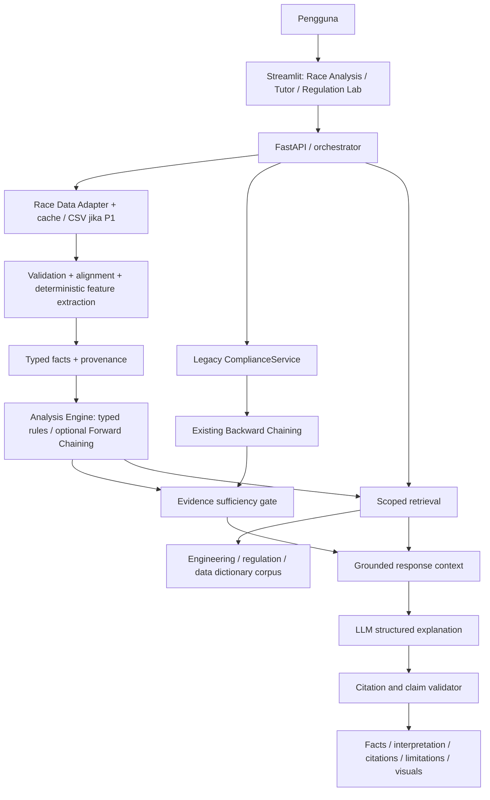

# PETA LENGKAP WORKSPACE — AI-Pakar
### F1 Technical Regulation Expert System / AI Pendamping Belajar Teknik F1

**Dibuat:** 20 November 2026
**Tujuan dokumen:** peta menyeluruh workspace ini untuk dibawa ke ChatGPT sebagai bahan brainstorming.
**Cakupan:** seluruh file, folder, kode, data, aturan, dokumen, hasil evaluasi, artefak runtime, dan riset — tanpa terkecuali.
**Sifat:** deskriptif. Dokumen ini memetakan apa yang **benar-benar ada**, bukan apa yang seharusnya ada. Klaim yang belum terbukti ditandai.
**Versi publik:** path absolut, nama pengguna, hash file, dan detail sesi pengembangan pribadi telah dihapus atau disamarkan. Konten teknis tidak diubah.

---

## 0. Cara pakai dokumen ini

1. Bagian 1–3 memberi konteks cepat (produk, status, lingkungan).
2. Bagian 4 adalah inventaris file lengkap — cocok untuk menjawab "file apa saja yang ada?".
3. Bagian 5–7 menjelaskan arsitektur, kode, dan kontrak data.
4. Bagian 8–10 adalah inti pengetahuan: aturan FIA, korpus dokumen, dataset, dan hasil evaluasi.
5. Bagian 11–15 menjelaskan antarmuka, skrip, test, dan deployment.
6. Bagian 16–17 merangkum riset dan posisi novelty.
7. Bagian 18 berisi temuan/inkonsistensi hasil pemetaan.
8. Bagian 19 adalah brief siap-tempel untuk ChatGPT (pertanyaan brainstorming).
9. Bagian 20 glosarium dan perintah cepat.

> **Penting:** semua aturan masih berstatus `reviewed` (demo), **belum** `active` dan **belum** disetujui manusia. Semua hasil kepatuhan adalah demo/decision-support, bukan sertifikasi FIA.

---

## 1. Identitas proyek & ringkasan eksekutif

| Item | Nilai |
|---|---|
| Nama proyek | AI-Pakar / F1 Technical Regulation Expert System |
| Nama paket Python | `f1-technical-regulation-expert-system` |
| Versi paket | 1.1.0 (`pyproject.toml`), ruleset versi 1.0.0 |
| Jenis | Prototipe akademik sistem pakar |
| Judul proyek | *Development of an Evidence-Based Motorsport Engineering Expert AI Using Retrieval-Augmented Generation* |
| Domain | Regulasi teknis Formula 1 2026, Section C |
| Sumber normatif | `FIA 2026 Formula One Regulations — Section C [Technical]`, **Issue 21, 19 Oktober 2026**, 254 halaman |
| Subdomain aturan | Fundamental dimensions & mass (C2.3 dan C4) |
| Target pengguna | Penggemar F1, mahasiswa, anggota klub F1 |
| Bukan target | Tim F1, FIA, scrutineer, sertifikasi kepatuhan seluruh mobil |
| Bahasa keluaran | Indonesia (penjelasan), Inggris (kode/istilah teknis) |
| Stack | Python, FastAPI, Streamlit, PyMuPDF, Pydantic, Sentence Transformers, Qdrant, scikit-learn, pytest |
| Metode inti | Backward Chaining deterministik 3-nilai + RAG + verifikasi sitasi; LLM opsional (nonaktif) |

### Angka kunci

| Metrik | Nilai |
|---|---|
| Aturan | **13 rule entry** = 5 compliance goal + 8 value subgoal |
| Status aturan | 13 `reviewed`, 0 `active`, 0 `draft`, 0 `deprecated`, semua `human_approved: false` |
| Fakta input yang didukung | **11 nama fakta** |
| Dokumen sumber terindeks | **4** (2 regulasi FIA + 2 jurnal) |
| Halaman dokumen | 254 + 84 + 17 + 8 = **363 halaman** |
| Chunk retrieval | **1.184** (Section C 987; Section A 160; BC journal 34; RAG journal 3) |
| Dataset keputusan | **18 kasus** (6 TRUE, 7 FALSE, 5 UNKNOWN) → 12 development + 6 held-out |
| Query retrieval | **10** |
| Test | **66** (pytest cache memuat 70 id; 4 id lama sudah tidak ada) |
| Endpoint API | 7 kanonik `/v1` + 5 alias legacy + `/rules`, `/sample-facts`, `/` |
| Akurasi keputusan (dataset sendiri) | 18/18 = 1.0 (internal & eksternal) |
| Retrieval | hit rate 0.9; MRR 0.9; precision@5 0.18; 1 miss (C4.2 vs C10.1) |
| LLM | `LLM_PROVIDER=none`; adapter ada, belum diuji |
| Antarmuka | Streamlit 4 tab, tema gelap ala Command Code |

### Status satu kalimat

Sistem sudah berjalan end-to-end untuk **5 ketentuan FIA 2026** dengan backward chaining deterministik, bukti halaman, dan UI; tetapi belum punya **rule 2025**, belum punya **jawaban generatif RAG**, belum punya **perbandingan lintas issue**, dan belum ada **validasi manusia**.

---

## 2. Snapshot lingkungan & status repo

| Item | Nilai |
|---|---|
| Working directory | `<PROJECT_ROOT>` (disamarkan) |
| OS | Windows (win32), shell PowerShell 5.1 |
| Python venv | `.venv` → **Python 3.14.10** |
| `requires-python` | `>=3.11` |
| Docker base image | `python:3.12-slim` (berbeda dari venv lokal) |
| Paket terpasang di venv | 86 distribusi |
| Ukuran `.venv` | ±1.407 MB |
| `.env` | **Tidak ada** (hanya `.env.example`) → semua default dipakai |
| Git | **Bukan repository git** (`fatal: not a git repository`) |
| CI | Tidak ada |
| Total file (di luar `.venv`) | **145 file** |
| Total ukuran proyek (di luar `.venv`) | ±133 MB (storage 95,5 MB; folder_dokumen 24,8 MB; knowledge_base 12,3 MB) |

Distribusi ekstensi (di luar `.venv`, `__pycache__`, `.git`):

| Ekstensi | Jumlah |
|---|---|
| `.py` | 50 |
| `.json` | 32 |
| `.md` | 23 |
| `.pdf` | 12 |
| `.jsonl` | 4 |
| tanpa ekstensi | 4 |
| `.TAG` | 2 |
| `.log` | 2 |
| `.gitignore` | 2 |
| `.toml` | 2 |
| `.txt` | 2 |
| `.sqlite`, `.jinja`, `.joblib`, `.lock`, `.safetensors`, `.yml`, `.example`, `.dockerignore`, `.png`, `.css` | masing-masing 1 |

---

## 3. Peta direktori & ukuran

```
AI-Pakar/
├── .commandcode/          2 file     <0,01 MB   preferensi taste
├── .pytest_cache/         5 file      0,01 MB   cache pytest (stale)
├── .streamlit/            1 file     <0,01 MB   tema Streamlit
├── .venv/                (tidak dipetakan) 1.407 MB  virtualenv
├── app/                  68 file      0,43 MB   34 file .py + __pycache__
├── configs/               1 file     <0,01 MB   contoh konfigurasi
├── datasets/              6 file      0,06 MB   dataset & hasil evaluasi
├── folder_dokumen/        9 file     24,76 MB   PDF pembanding + catatan sumber
├── frontend/              4 file      0,07 MB   Streamlit + CSS + referensi UI
├── knowledge_base/       20 file     12,30 MB   PDF sumber, hasil ekstraksi, aturan, fakta
├── research/             10 file      0,14 MB   9 markdown + 1 screenshot
├── scripts/              16 file      0,06 MB   7 skrip + __pycache__
├── storage/              28 file     95,51 MB   model cache, Qdrant, log
├── tests/                23 file      0,23 MB   8 file .py + __pycache__
└── (root)                11 file      0,07 MB   dokumen proyek + Docker + deps
```

---

## 4. Inventaris file lengkap

### 4.1 Root (11 file)

| File | Ukuran | Isi/peran |
|---|---:|---|
| `.dockerignore` | 82 B | Exclude `.venv/`, `storage/`, `__pycache__/`, `.git/`, `.env`, `*.log` |
| `.env.example` | 1.282 B | Template env: LLM, retrieval, API, `ALLOW_REVIEWED_RULES` |
| `.gitignore` | 265 B | Ignore `.env`, `.venv`, cache Python, `storage/`, `*.log` |
| `docker-compose.yml` | 1.127 B | 3 service: `qdrant`, `api`, `ui` |
| `Dockerfile` | 534 B | `python:3.12-slim`, install requirements, expose 8000/8501 |
| `project_context.md` | 26.241 B (251 baris) | Master specification & handover: FR, BR, gate, non-goals, kontrak status, aturan agen |
| `PROMPT.md` | 14.829 B (384 baris) | Brief awal berbahasa Indonesia: audit dokumen, arsitektur, aturan, evaluasi |
| `pyproject.toml` | 328 B | Metadata proyek + konfigurasi pytest |
| `rangkuman_proyek.md` | 16.834 B (329 baris) | Ringkasan proyek untuk brainstorming: arsitektur, hasil, gap, prior art, pertanyaan |
| `README.md` | 11.116 B (183 baris) | Dokumentasi teknis: quick start, endpoint, aturan, evaluasi, limitasi |
| `requirements.txt` | 266 B | 12 dependency utama dengan pin versi |

### 4.2 `app/` — 34 file Python (tanpa `__pycache__`)

| File | Baris | Peran & simbol utama |
|---|---:|---|
| `app/__init__.py` | 0 | Penanda paket |
| `app/config.py` | 91 | `ROOT`, `STORAGE_DIR`, `MODEL_CACHE_DIR`, `VECTOR_DB_DIR`, `LOG_DIR`, `PROCESSED_DIR`, `RULES_PATH`, `SAMPLE_FACTS_PATH`, `MANIFEST_PATH`, `DATASETS_DIR`; `ensure_directories()`, `configure_local_caches()`, `Settings`, `load_settings()`, `get_logger()` |
| `app/main.py` | 113 | `FastAPI` app v1.1.0, CORS `*`, router, exception handler untuk `FactBatchValidationError` (422), `FactConflictError` (409), `RequestValidationError` (422), `Exception` (500); `GET /`; `run()` |
| `app/api/__init__.py` | 0 | — |
| `app/api/routes.py` | 175 | Singleton `service()` dan `retriever()`; payload helper; `health`, `goals`, `rules`, `check_v1`, `check_legacy`, `check_all`, `search_v1`, `retrieve_legacy`, `retrieval_status`, `extract_facts`, `sample_facts` |
| `app/document_processing/__init__.py` | 0 | — |
| `app/document_processing/pdf_loader.py` | 54 | `open_document`, `read_metadata`, `extract_page`, `extract_pages`; `OCR_PAGE_CHAR_THRESHOLD = 40`; ekstraksi teks + block + font size + bold |
| `app/document_processing/text_extractor.py` | 183 | `slugify`, `classify`, `parse_fia_filename`, `load_overrides`, `render_markdown`, `build_document`, `write_document`; SHA-256, halaman, metadata, override manual |
| `app/document_processing/chunker.py` | 132 | `Chunk` dataclass; `ARTICLE_RE`, `SUBARTICLE_RE`, `NOISE_PATTERNS`; `chunk_pages`, `chunks_from_processed_dir`; buang TOC & header/footer |
| `app/rag/__init__.py` | 0 | — |
| `app/rag/embeddings.py` | 132 | `normalize_for_tfidf`, `EmbeddingError`, `EmbeddingBackend`, `TfidfEmbeddingBackend` (max_features 4096), `SentenceTransformerBackend`, `_sentence_transformer_cached`, `get_embedding_backend` (auto/tfidf/ST) |
| `app/rag/vector_store.py` | 184 | `SearchHit`; `TfidfVectorStore` (joblib), `NumpyVectorStore` (cosine in-memory), `QdrantVectorStore` (local/URL, filter article/document/type) |
| `app/rag/retriever.py` | 145 | `Retriever.from_chunks`, `load_or_build`, `search` (default hanya `regulation`), `describe`; `TFIDF_INDEX_PATH`, `DENSE_META_PATH`, `DENSE_COLLECTION="regulation_chunks"` |
| `app/llm/__init__.py` | 0 | — |
| `app/llm/base.py` | 41 | `LLMError`, `ChatMessage`, `LLMProvider` ABC, `get_provider()` |
| `app/llm/api_provider.py` | 42 | `OpenAICompatibleProvider` → `POST /chat/completions`, Bearer key |
| `app/llm/local_provider.py` | 37 | `OllamaProvider` → `POST /api/chat`, stream=False |
| `app/llm/fact_extractor.py` | 258 | `DeterministicFactExtractor` (regex ID/EN), `LLMFactExtractor` (JSON ketat + validasi `FACT_SPECS`), `get_extractor`; `SYSTEM_PROMPT`, `MEASUREMENT_KEYWORDS` |
| `app/expert_system/__init__.py` | 0 | — |
| `app/expert_system/knowledge_base.py` | 120 | `KnowledgeBase` (filter rule runnable, demo mode), `from_file`, `from_dict`, lifecycle counts, `rules_for_goal`, `goals`, `load_facts_from_file`, `load_document_manifest` |
| `app/expert_system/rule_engine.py` | 324 | `RuleEngine`; `render_operand`, `render_expr`; `Resolved`, `ConditionOutcome`; resolusi fact/goal_value/expr; evaluasi kondisi; `evaluate_rule`; konversi satuan; operator `< <= > >= == != in not_in` |
| `app/expert_system/backward_chaining.py` | 199 | `BackwardChainingEngine` (`MAX_DEPTH=25`), `prove()`, `_combine` boolean/value, cycle detection, memoization, `_build_trace`, `check_goal()` |
| `app/expert_system/explanation.py` | 139 | Penjelasan template deterministik (bukan LLM): `format_value`, `condition_text`, `render_trace_text`, `build_explanation` |
| `app/expert_system/service.py` | 400 | `ComplianceService`: validasi fakta, `goal_facts`, `requirements`, `check`, `check_all`, sitasi + verifikasi kutipan, diagnostik, `LIMITATIONS`, `DEMO_WARNING`, `normalize_text` |
| `app/schemas/__init__.py` | 0 | — |
| `app/schemas/units.py` | 29 | `UnitMismatch`, `UNIT_TABLE` (mm/cm/m, kg/g/t, s, deg, %), `convert_unit`, `is_number` |
| `app/schemas/facts.py` | 115 | `FactOrigin`, `Fact`, `FactInput`, `FactConflict`, `FactConflictError`, `FactStore`, `MissingFact`, `ExtractedFact`, `ExtractionResult` |
| `app/schemas/fact_specs.py` | 138 | `FACT_SPECS` (11 fakta), `ALLOWED_FACT_NAMES`, `FactValidationError`, `FactBatchValidationError`, `validate_and_normalize` |
| `app/schemas/rules.py` | 165 | `RuleStatus`, `Operator`, `Expr`, `Operand`, `Condition`, `EvidenceSpan`, `RuleSource`, `RuleValidation`, `Conclusion`, `Rule` (+validator lifecycle), `RuleSet` |
| `app/schemas/results.py` | 136 | `TruthValue`, `ExternalStatus`, `DiagnosticCode`, `Diagnostic`, `ConditionEvaluation`, `RuleEvaluation`, `TraceNode`, `GoalResult`, `Citation`, `CheckReport`, `RetrievalHit` |
| `app/schemas/api.py` | 71 | `CheckRequest`, `LegacyCheckRequest`, `CheckAllRequest`, `SearchRequest`, `ExtractRequest`, `GoalInfo`, `ErrorEnvelope` |
| `app/evaluation/__init__.py` | 0 | — |
| `app/evaluation/metrics.py` | 74 | `classification_metrics`, `set_precision_recall_f1`, `retrieval_metrics` |
| `app/evaluation/evaluator.py` | 244 | `Evaluator.run_decision_suite`, `run_retrieval_suite`, `run_all`; `explanation_completeness`, `trace_consistency`; agregasi dev/held-out |

### 4.3 `frontend/` (3 file sumber)

| File | Ukuran | Peran |
|---|---:|---|
| `streamlit_app.py` | 24.968 B | UI 4 tab: Pemeriksaan, Cari bukti, Aturan & sumber, Tentang; form fakta dinamis; ekstraksi teks; render report; download JSON; switch backend In-process/FastAPI |
| `theme.css` | 4.822 B | Tema gelap `#090a0c`, aksen `#e8eaed`, sudut tajam, tab, tombol, form, tabel, responsif, `prefers-reduced-motion` |
| `UI_REFERENCES.md` | 1.148 B | Catatan referensi komponen gratis 21st.dev (Dashboard Sidebar, Sidebar, Minimal Button, Input) + alasan adaptasi ke Streamlit |
| `__pycache__/` | — | Cache Python |

### 4.4 `scripts/` (7 file Python)

| File | Baris | Fungsi | Output/side effect |
|---|---:|---|---|
| `extract_documents.py` | 118 | Ekstraksi semua PDF di `knowledge_base/source_documents` | 3 file per dokumen (`.json`, `.md`, `.pages.jsonl`) + `document_manifest.json` |
| `build_index.py` | 30 | Bangun ulang indeks retrieval (`force=True`) | Qdrant/TF-IDF di `storage/vector_db` |
| `run_evaluation.py` | 170 | Jalankan decision + retrieval suite | `datasets/evaluation_results.json`, `research/evaluation_results.md` |
| `validate_rules.py` | 105 | Cek kutipan setiap rule ada di halaman yang dirujuk | `research/rule_validation_log.md`; exit 1 jika gagal |
| `split_dataset.py` | 55 | Split deterministik 18 kasus → 12 dev + 6 held-out | `development_cases.json`, `heldout_cases.json`, `test_cases.json` |
| `migrate_rules_v2.py` | 73 | Migrasi status rule ke `reviewed`, isi validation, `human_approved=false` | Menulis ulang `rules.json` (one-off) |
| `add_external_status.py` | 33 | Tambah `expected_external_status` ke expected results | Menulis `expected_results.json` (one-off) |

### 4.5 `tests/` (8 file Python)

| File | Baris | Cakupan |
|---|---:|---|
| `conftest.py` | 31 | Set env `EMBEDDING_BACKEND=tfidf`, `LLM_PROVIDER=none`; fixture `kb` (session), `service`, `facts_factory` |
| `test_backward_chaining.py` | 145 | Batas wheelbase, missing→UNKNOWN, subgoal minimum mass, heat hazard, propagasi missing fact, NOT_APPLICABLE, cycle detection, konflik aturan |
| `test_document_processing.py` | 59 | Manifest 4 dokumen + SHA-256, 254 halaman Section C, output ada, PDF loader, chunk metadata, TOC tidak diindeks, jurnal terindeks |
| `test_end_to_end.py` | 180 | 18 kasus dataset lewat `TestClient`, health, goals, rules lifecycle, unknown goal, version mismatch, konflik 409, invalid 422, check-all 5 goal, ekstraksi deterministik, search exclude methodology, retrieval C2.3.3, legacy endpoint |
| `test_retrieval.py` | 79 | Query wheelbase, metadata & skor, filter artikel, query kosong, exclude journal, NumPy cosine, Qdrant local |
| `test_rule_engine.py` | 88 | Konversi satuan, TRUE/FALSE, missing fact+unit, mismatch→UNKNOWN, `in`, boolean equality, ekspresi aritmetika, tanpa pembulatan, NOT_APPLICABLE |
| `test_rule_sources.py` | 62 | Semua kutipan ada di halaman, semua rule reviewed & tidak approved, active tanpa approval ditolak, reviewed bisa dimatikan |
| `__init__.py` | 0 | — |

### 4.6 `knowledge_base/` (20 file)

| File | Ukuran | Peran |
|---|---:|---|
| `document_manifest.json` | 6.941 B | Manifest 4 dokumen: SHA-256, ukuran, halaman, issue, tanggal, status ekstraksi, path output |
| `metadata/document_overrides.json` | 2.181 B | Metadata hasil verifikasi manual (judul, publisher, penulis, DOI, tanggal) |
| `facts/sample_facts.json` | 1.293 B | 11 fakta contoh untuk mobil fiktif |
| `rules/rules.json` | 28.275 B | Ruleset 2026: 13 rule, sumber, kondisi, validasi |
| `processed_documents/2024-konvens-main-6.json` | 75.274 B | Dokumen jurnal RAG, 8 halaman |
| `processed_documents/2024-konvens-main-6.md` | 30.205 B | Markdown dengan penanda halaman |
| `processed_documents/2024-konvens-main-6.pages.jsonl` | 30.472 B | Satu baris per halaman |
| `processed_documents/backward-chaining-...-knowledge-bases.json` | 106.802 B | Jurnal BC, 17 halaman |
| `processed_documents/backward-chaining-...-knowledge-bases.md` | 47.021 B | Markdown |
| `processed_documents/backward-chaining-...-knowledge-bases.pages.jsonl` | 49.457 B | JSONL |
| `processed_documents/fia-2026-...-section-a-...-iss-03-2026-06-25.json` | 664.757 B | Section A, 84 halaman |
| `processed_documents/fia-2026-...-section-a-....md` | 242.617 B | Markdown |
| `processed_documents/fia-2026-...-section-a-....pages.jsonl` | 254.932 B | JSONL |
| `processed_documents/fia-2026-...-section-c-...-iss-21-2026-10-19.json` | 2.004.412 B | Section C, 254 halaman |
| `processed_documents/fia-2026-...-section-c-....md` | 657.562 B | Markdown |
| `processed_documents/fia-2026-...-section-c-....pages.jsonl` | 691.730 B | JSONL |
| `source_documents/REGULASI FIA/FIA 2026 F1 Regulations - Section A [General Provisions] - Iss 03 - 2026-06-25.pdf` | 972.269 B | PDF sumber (84 hlm) |
| `source_documents/REGULASI FIA/FIA 2026 F1 Regulations - Section C [Technical] - Iss 21 - 2026-10-19.pdf` | 4.617.723 B | PDF sumber utama (254 hlm) |
| `source_documents/Jurnal/2024.konvens-main.6.pdf` | 351.935 B | Jurnal RAG & sitasi (8 hlm) |
| `source_documents/Jurnal/Backward chaining inference as a database stored procedure ... knowledge bases.pdf` | 2.062.096 B | Jurnal backward chaining (17 hlm) |

### 4.7 `datasets/` (6 file)

| File | Ukuran | Isi |
|---|---:|---|
| `test_cases.json` | 10.026 B | Gabungan 18 kasus (generated convenience artifact) |
| `development_cases.json` | 6.960 B | 12 kasus development |
| `heldout_cases.json` | 3.442 B | 6 kasus held-out |
| `expected_results.json` | 6.555 B | Expected status internal/eksternal, rule, article, missing facts, alasan |
| `retrieval_cases.json` | 1.647 B | 10 query + artikel gold |
| `evaluation_results.json` | 36.867 B | Hasil run terakhir: 18 baris keputusan + 10 retrieval + agregat + by_split |

### 4.8 `research/` (10 file)

| File | Baris/Ukuran | Isi |
|---|---:|---|
| `architecture.md` | 145 baris | Peta komponen, alur, semantik inferensi, RAG, batas LLM, storage, API, keamanan, limitasi |
| `document_analysis.md` | 116 baris | Analisis 4 dokumen, struktur Section C, kandidat aturan, dependensi silang, kualitas ekstraksi, rekomendasi subdomain |
| `rule_selection.md` | 130 baris | 5 rule card lengkap: pasal, kutipan, fakta, TRUE/FALSE/UNKNOWN, alasan, dependensi; kandidat yang belum diaktifkan |
| `rule_validation_log.md` | 35 baris | Tabel 13 rule: quote check PASS, human_approved False, reviewer `internal_agent_check`, test cases; kolom sign-off kosong |
| `evaluation_plan.md` | 87 baris | Tujuan, dataset, metrik, rencana A/B/C, prosedur, hasil ringkas, ancaman validitas |
| `evaluation_results.md` | 82 baris | Hasil lengkap: agregat, split, per-case, confusion matrix, retrieval, limitasi |
| `rencana_pengembangan_proyek.md` | 53 baris | Rencana 6 tahap: kunci skenario → rule 2025 → compare → RAG answer → UI → evaluasi |
| `pembanding_simulator_regulasi.md` | 73 baris | Riset pembanding produk/publikasi, matriks bukti, revisi klaim novelty, skenario wheelbase 2025 vs 2026 |
| `transkrip_percakapan_ai_pakar.md` | 428 baris | Catatan sesi pengembangan internal; isi tidak dirinci pada versi publik |
| `percakapan_assets/tangkapan_layar_tab_navigasi.png` | 11,5 KB | Screenshot tab Streamlit yang berhimpitan (bukti perbaikan CSS) |

### 4.9 Konfigurasi kecil

| File | Isi |
|---|---|
| `configs/settings.example.json` | Dokumentasi default: llm, retrieval, api, inference (`max_depth 25`, `allow_reviewed_rules`, `unknown_is_never_false`, `violation_dominates`) |
| `.streamlit/config.toml` | Tema dark: primary `#e8eaed`, bg `#090a0c`, secondary `#15181c`, text `#e8e9eb`, `toolbarMode="minimal"` |
| `.commandcode/taste/taste.md` | Index taste → link ke file kategori |
| `.commandcode/taste/taste-—-command-code/taste.md` | 7 preferensi kerja (isolasi workspace, user menjalankan server sendiri, perintah PowerShell 5.1, jawab langsung, brief dulu sebelum eksekusi) |
| `.pytest_cache/README.md` | Dokumentasi bawaan pytest |
| `.pytest_cache/CACHEDIR.TAG` | Penanda direktori cache |
| `.pytest_cache/.gitignore` | `*` |
| `.pytest_cache/v/cache/nodeids` | 70 id test (termasuk 4 id lama) |
| `.pytest_cache/v/cache/lastfailed` | 3 kegagalan lama dari versi test sebelumnya |

### 4.10 `storage/` (28 file, 95,51 MB) — artefak runtime, gitignored

| File | Ukuran | Peran |
|---|---:|---|
| `logs/app.log` | 36.030 B | Log aplikasi: build index, setiap `check`, load retriever |
| `model_cache/.agent_harnesses.json` | 9.285 B | Katalog harness agen AI (bukan bagian aplikasi; artefak tooling) |
| `model_cache/sentence-transformers/CACHEDIR.TAG` | 195 B | Penanda cache |
| `model_cache/sentence-transformers/models--sentence-transformers--all-MiniLM-L6-v2/refs/main` | 40 B | Ref model |
| `.../snapshots/1110a243.../config.json` | 612 B | Konfigurasi model |
| `.../config_sentence_transformers.json` | 116 B | Konfigurasi ST |
| `.../model.safetensors` | 90.868.376 B | Bobot model MiniLM |
| `.../modules.json` | 349 B | Pipeline modul |
| `.../README.md` | 10.502 B | Kartu model |
| `.../sentence_bert_config.json` | 53 B | Konfigurasi BERT |
| `.../special_tokens_map.json` | 112 B | Special tokens |
| `.../tokenizer.json` | 466.247 B | Tokenizer |
| `.../tokenizer_config.json` | 350 B | Konfigurasi tokenizer |
| `.../vocab.txt` | 231.508 B | Vocabulary |
| `.../1_Pooling/config.json` | 190 B | Pooling |
| `.../.no_exist/.../adapter_config.json` | 0 B | Placeholder |
| `.../.no_exist/.../added_tokens.json` | 0 B | Placeholder |
| `.../.no_exist/.../chat_template.jinja` | 0 B | Placeholder |
| `.../.no_exist/.../preprocessor_config.json` | 0 B | Placeholder |
| `.../.no_exist/.../processor_config.json` | 0 B | Placeholder |
| `.../.no_exist/.../video_preprocessor_config.json` | 0 B | Placeholder |
| `.../.no_exist/.../2_Normalize/config.json` | 0 B | Placeholder |
| `model_cache/xet/logs/xet_20261117T113334140+0700_14840.log` | 85.651 B | Log unduhan Hugging Face Xet |
| `vector_db/dense_index.json` | 141 B | Metadata indeks: ST, MiniLM, dim 384, 1184 chunk |
| `vector_db/tfidf_index.joblib` | 2.357.696 B | Indeks TF-IDF fallback |
| `vector_db/qdrant/.lock` | 13 B | Lock file Qdrant local |
| `vector_db/qdrant/meta.json` | 590 B | Metadata koleksi `regulation_chunks` (384, Cosine) |
| `vector_db/qdrant/collection/regulation_chunks/storage.sqlite` | 6.086.656 B | Penyimpanan koleksi Qdrant |

### 4.11 `folder_dokumen/` (9 file, 24,76 MB) — bahan riset, belum terintegrasi

| File | Halaman | Ukuran | Catatan |
|---|---:|---:|---|
| `FIA 2025 F1 Technical Regulations - Issue 03 - 2025-04-07.pdf` | 179 | 2.242.504 B | Pembanding 2025; wheelbase 3.4.2 = 3600 mm |
| `FIA 2026 Section C Technical - Issue 16 - 2026-02-27.pdf` | 259 | 5.454.798 B | Issue awal 2026 |
| `FIA 2026 Section C Technical - Issue 19 - 2026-06-25.pdf` | 257 | 4.432.143 B | Issue 2026 |
| `FIA 2026 Section C Technical - Issue 20 - 2026-08-05.pdf` | 254 | 5.825.714 B | Pembanding langsung Issue 21 |
| `Jurnal/2024.konvens-main.6.pdf` | 8 | 351.935 B | Duplikat byte-identik dari knowledge_base |
| `Jurnal/Backward chaining inference ... knowledge bases.pdf` | 17 | 2.062.096 B | Duplikat byte-identik |
| `REGULASI FIA/FIA 2026 F1 Regulations - Section A [General Provisions] - Iss 03 - 2026-06-25.pdf` | 84 | 972.269 B | Duplikat byte-identik |
| `REGULASI FIA/FIA 2026 F1 Regulations - Section C [Technical] - Iss 21 - 2026-10-19.pdf` | 254 | 4.617.723 B | Duplikat byte-identik (dokumen utama) |
| `SUMBER_UNDUHAN.md` | — | 1.943 B | Tabel sumber resmi FIA + kandidat perbandingan |

### 4.12 `.venv/`

Virtual environment lokal, 86 paket, Python 3.14.10. Tidak dipetakan per file (1.407 MB). Semua cache model diarahkan ke `storage/model_cache` lewat `app/config.py`.

---

## 5. Arsitektur sistem & alur data

```
┌──────────────────────────────────────────────────────────────────────┐
│                          Streamlit UI (8501)                         │
│  Tab 01 Pemeriksaan │ 02 Cari bukti │ 03 Aturan │ 04 Tentang          │
└───────────────┬──────────────────────────────────┬───────────────────┘
                │ in-process                        │ HTTP (FastAPI mode)
                ▼                                   ▼
      ┌───────────────────┐               ┌────────────────────┐
      │ ComplianceService │◄──────────────│  FastAPI (8000)    │
      │  (orchestrator)   │               │  app/api/routes.py │
      └─────────┬─────────┘               └─────────┬──────────┘
                │                                   │
    ┌───────────┼───────────────┬───────────────────┴──────────┐
    ▼           ▼               ▼                              ▼
┌────────┐ ┌──────────────┐ ┌──────────────┐          ┌────────────────┐
│Knowledge│ │Backward      │ │Explanation   │          │ Retriever      │
│Base     │ │Chaining      │ │(template)    │          │ RAG            │
│rules.json│ │Engine        │ │              │          │                │
└────┬────┘ └──────┬───────┘ └──────────────┘          └───────┬────────┘
     │             ▼                                         │
     │      ┌──────────────┐                  ┌──────────────┴───────────┐
     │      │ RuleEngine   │                  │ Embeddings                │
     │      │ (facts/units)│                  │ ST MiniLM  │ TF-IDF       │
     │      └──────────────┘                  └──────┬───────────┬────────┘
     │                                               ▼           ▼
     │                                        Qdrant local   TF-IDF index
     ▼
┌──────────────────────────────────────────────────────────────────────┐
│ Ingestion: PDF → pdf_loader → text_extractor → chunker → index       │
│ Files: scripts/extract_documents.py, scripts/build_index.py          │
└──────────────────────────────────────────────────────────────────────┘
```

### Alur pemeriksaan kepatuhan

1. Pengguna memilih `goal_id` (5 goal kepatuhan) dan mengisi fakta (form atau teks).
2. `ComplianceService.build_fact_store()` memvalidasi nama, tipe, satuan, nilai minimum; duplikat konflik → `FactConflictError` (409).
3. `check()` memeriksa `document_issue` (harus "21") dan keberadaan goal; jika tidak → `UNSUPPORTED` + diagnostik.
4. `BackwardChainingEngine.prove(goal)`:
   - ambil rule runnable untuk goal;
   - evaluasi `applies_if` (konteks);
   - evaluasi `conditions`; operand bisa `fact`, `const`, `expr`, `goal_value`;
   - `goal_value` memicu subgoal rekursif (contoh C4.2 → C4.1 → C4.6);
   - gabungkan: FALSE menang, lalu TRUE, lalu UNKNOWN; memoization; deteksi siklus; depth maks 25.
5. `ComplianceService` menyusun `CheckReport`: status eksternal, aturan penentu, kutipan, kondisi, fakta hilang, rules evaluated, trace, diagnostik, limitasi.
6. Sitasi diverifikasi: kutipan dinormalisasi dan dicari di teks halaman yang tersimpan; gagal → `SOURCE_MISSING`; jika aturan penentu tidak terverifikasi, `SATISFIED`/`VIOLATED` diturunkan menjadi `INSUFFICIENT_DATA`.
7. Penjelasan dibuat oleh template deterministik, bukan LLM.

### Alur retrieval

```
PDF → PyMuPDF (per halaman, blocks, font size) → JSON/MD/JSONL
    → chunker (buang TOC & header/footer; metadata article/subarticle/page)
    → embedding (MiniLM 384d atau TF-IDF max_features 4096)
    → Qdrant local / TF-IDF joblib
    → search(query, top_k, article?, document_id?, include_methodology?)
    → RetrievalHit (document_id, document_type, article, page, text, score, chunk_id)
```

### Prinsip pemisahan tugas

| Komponen | Boleh | Tidak boleh |
|---|---|---|
| RAG | Mengambil bukti + metadata + skor | Menentukan TRUE/FALSE, menyatakan patuh |
| LLM | Mengusulkan fakta dari teks, menyusun narasi (belum aktif) | Membuat/mengubah aturan, mengubah verdict, mengaktifkan rule |
| Rule engine / BC | Menghitung kondisi, subgoal, verdict deterministik | Mengarang nilai, mengabaikan satuan |
| Explanation | Meringkas trace engine | Menafsirkan ulang hasil |

---

## 6. Model data & kontrak

### 6.1 Fakta yang didukung (11)

| Nama fakta | Tipe | Satuan | Aturan/nilai | Dipakai goal |
|---|---|---|---|---|
| `max_half_width_excluding_tyres_and_rims` | number | mm | min 0 | half_width_compliance |
| `wheelbase` | number | mm | min 0 | wheelbase_compliance |
| `cockpit_position_distance` | number | mm | min 0 | cockpit_position_compliance |
| `car_mass` | number | kg | min 0 | minimum_mass_compliance |
| `nominal_tyre_mass` | number | kg | min 0 | minimum_mass_compliance, mass_distribution_compliance |
| `front_axle_mass` | number | kg | min 0 | mass_distribution_compliance |
| `rear_axle_mass` | number | kg | min 0 | mass_distribution_compliance |
| `session_type` | string | — | `Q`, `SQ`, `R`, `FP`, `SPRINT`, `OTHER` | minimum_mass, mass_distribution |
| `session_category` | string | — | `TTCS`, `LTCS` | minimum_mass |
| `heat_hazard_declared` | boolean | — | — | minimum_mass |
| `competition_heat_hazard_declared` | boolean | — | — | minimum_mass |

### 6.2 Satuan yang didukung (`UNIT_TABLE`)

| Dimensi | Satuan | Faktor ke basis |
|---|---|---|
| length | mm / cm / m | 1 / 10 / 1000 |
| mass | kg / g / t | 1 / 0,001 / 1000 |
| time | s | 1 |
| angle | deg | 1 |
| percent | % | 1 |

Aturan: satuan tidak kompatibel → `UNKNOWN` + detail `incompatible units`, **bukan** FALSE. Tidak ada pembulatan nilai batas (sesuai C2.5).

### 6.3 Skema aturan (`Rule`)

```
rule_id, name, source{document_id, document, issue, article, page, quote, evidence_span},
applies_if[Condition], conditions[Condition],
conclusion{goal, kind: boolean|value, value?, unit?, expr?},
status: draft|reviewed|active|deprecated,
validation{verified_against, verified_on, method, reviewer?, reviewed_at?, human_approved, test_case_ids[], notes?},
notes
```

`Condition` = `left Operand`, `operator`, `right Operand?`, `unit?`, `description?`.
`Operand` = tepat satu dari `const`, `fact`, `goal_value`, `expr`.
`Expr` = `op: add|sub|mul|div`, `args: Operand[]` (min 2).

Validasi lifecycle:
- `reviewed`/`active` wajib punya `validation`;
- `active` wajib `human_approved=true` + `reviewer`, `reviewed_at`, `verified_against`, `verified_on`, `method`;
- `RuleSet` menolak `rule_id` duplikat;
- satu goal tidak boleh mencampur rule boolean dan value.

### 6.4 Status & diagnostik

| Internal (proof) | Eksternal (API/UI) |
|---|---|
| `TRUE` | `SATISFIED` |
| `FALSE` | `VIOLATED` |
| `UNKNOWN` | `INSUFFICIENT_DATA` |
| — | `NOT_APPLICABLE` (semua kandidat rule definitif tidak berlaku) |
| — | `UNSUPPORTED` (goal/issue di luar ruleset) |
| — | `ERROR` (kegagalan sistem, bukan verdict) |

Diagnostik: `INVALID_INPUT`, `CONFLICTING_INPUT`, `SOURCE_MISSING`, `VERSION_MISMATCH`, `UNSUPPORTED_GOAL`, `RULE_NOT_APPROVED`, `INTERNAL_ERROR`.

Aturan penggabungan:
- ada rule FALSE → goal FALSE (konservatif);
- TRUE + FALSE bersamaan → FALSE, `rule_conflict=true`;
- UNKNOWN tidak pernah diubah menjadi FALSE;
- rule tidak berlaku → `NOT_APPLICABLE`, bukan `SATISFIED`.

### 6.5 Bentuk `CheckReport`

Field: `goal_id`, `status`, `internal_status`, `value`, `scope`, `explanation`, `rule_id`, `rule_name`, `rule_status`, `validation_warning`, `source`, `applicability_conditions[]`, `conditions[]`, `missing_facts[]`, `conflicts[]`, `diagnostics[]`, `rules_evaluated[]`, `citations[]`, `facts_used{}`, `proof_trace`, `regulation{}`, `limitations[]`, `rule_conflict`, `generated_at`.

`TraceNode`: `node_id`, `goal`, `kind`, `status`, `value`, `rule_id`, `rule_name`, `expression`, `source`, `conditions[]`, `children[]`, `notes[]`.

---

## 7. Knowledge base aturan — 13 rule entry

### 7.1 Tabel aturan

| # | Rule ID | Goal | Kind | Artikel | Hlm | Ketentuan | Status |
|---|---|---|---|---|---:|---|---|
| 1 | `FIA26-C2.3.1-HALF-WIDTH` | half_width_compliance | boolean | C2.3.1 | 10 | Tidak ada bagian non-eksklusi > 950 mm dari plane Y=0 | reviewed |
| 2 | `FIA26-C2.3.3-WHEELBASE` | wheelbase_compliance | boolean | C2.3.3 | 11 | Wheelbase ≤ 3400 mm | reviewed |
| 3 | `FIA26-C2.3.5-COCKPIT-POSITION` | cockpit_position_compliance | boolean | C2.3.5 | 11 | Jarak XA=0–XC=0 ∈ [1830, 2030] mm | reviewed |
| 4 | `FIA26-C4.1-BASE-MASS-Q` | base_minimum_mass | value 726 kg | C4.1 | 59 | Sesi SQ/Q → base 726 kg | reviewed |
| 5 | `FIA26-C4.1-BASE-MASS-OTHER` | base_minimum_mass | value 724 kg | C4.1 | 59 | Sesi lain → base 724 kg | reviewed |
| 6 | `FIA26-C4.6-HEAT-INCREASE-TTCS-DECLARED` | heat_hazard_mass_increase | value 5 kg | C4.6 | 60 | TTCS + heat hazard sesi + competition | reviewed |
| 7 | `FIA26-C4.6-HEAT-INCREASE-LTCS-COMPETITION` | heat_hazard_mass_increase | value 2 kg | C4.6 | 60 | Competition heat hazard + LTCS | reviewed |
| 8 | `FIA26-C4.6-HEAT-INCREASE-TTCS-NOT-DECLARED` | heat_hazard_mass_increase | value 2 kg | C4.6 | 60 | Competition heat hazard + TTCS tanpa heat sesi | reviewed |
| 9 | `FIA26-C4.6-HEAT-INCREASE-NONE` | heat_hazard_mass_increase | value 0 kg | C4.1 | 59 | Tidak ada heat hazard (sesi & competition) | reviewed |
| 10 | `FIA26-C4.1-MINIMUM-MASS-VALUE` | minimum_mass | value expr | C4.1 | 59 | base + nominal tyre mass + heat increase | reviewed |
| 11 | `FIA26-C4.2-MINIMUM-MASS-NO-HEAT` | minimum_mass_excluding_heat_hazard | value expr | C4.2 | 59 | base + nominal tyre mass | reviewed |
| 12 | `FIA26-C4.1-MINIMUM-MASS` | minimum_mass_compliance | boolean | C4.1 | 59 | car_mass ≥ minimum_mass | reviewed |
| 13 | `FIA26-C4.2-MASS-DISTRIBUTION` | mass_distribution_compliance | boolean | C4.2 | 59 | front ≥ 0,44×; rear ≥ 0,54× | reviewed |

### 7.2 Rantai backward chaining nyata

```
mass_distribution_compliance (C4.2, Q/SQ)
├── minimum_mass_excluding_heat_hazard (C4.2)
│   ├── base_minimum_mass (C4.1: 726 jika Q/SQ, 724 lainnya)
│   └── nominal_tyre_mass (FACT input)
├── front_axle_mass ≥ 0.44 × minimum_mass_excluding_heat_hazard
└── rear_axle_mass  ≥ 0.54 × minimum_mass_excluding_heat_hazard

minimum_mass_compliance (C4.1)
├── minimum_mass
│   ├── base_minimum_mass
│   ├── nominal_tyre_mass (FACT input)
│   └── heat_hazard_mass_increase (C4.6: 5 / 2 / 0 kg)
└── car_mass ≥ minimum_mass
```

### 7.3 Kutipan sumber (verbatim, terverifikasi otomatis)

| Rule | Kutipan |
|---|---|
| C2.3.1 | “Except for the tyres, the Wheel Rims, and parts attached to the Wheel Rims as defined in Article C10.7.6, no part of the car may lie more than 950mm from the plane Y=0 at Legality Setup.” |
| C2.3.3 | “The distance between the planes XF = 0 and XR = 0 must be less than or equal to 3400mm at Legality Setup.” |
| C2.3.5 | “The distance between XA = 0 and XC = 0 must be greater than or equal to 1830mm and less than or equal to 2030mm.” |
| C4.1 (base) | “During the Sprint Qualifying and Qualifying sessions, The Minimum Mass is 726kg plus the Nominal Tyre Mass. In all other sessions, the Minimum Mass is 724kg plus the Nominal Tyre Mass.” |
| C4.1 (compliance) | “At all times during the Competition, Car Mass must not be less than the Minimum Mass.” |
| C4.1 (heat) | “When a Heat Hazard is declared, the Minimum Mass will be increased by the Heat Hazard Mass Increase.” |
| C4.6 (5 kg) | “During a TTCS for which a Heat Hazard has been declared: a. The Heat Hazard Mass Increase is 5kg.” |
| C4.6 (2 kg) | “During a Competition at which a Heat Hazard has been declared for any session; For any LTCS or TTCS for which a Heat Hazard has not been declared: c. A Heat Hazard Mass Increase of 2kg will be applied.” |
| C4.2 (distribution) | “At all times during the Qualifying and Sprint Qualifying Sessions, with the car resting on a horizontal plane: i. …front axle… ≥ Minimum Mass … factored by 0.44. ii. …rear axle… ≥ … factored by 0.54.” |
| C4.2 (heat exclusion) | “If, when required for checking, a Heat Hazard has been declared, the increase in mass will not be considered.” |

### 7.4 Scope ruleset

`scope`: “Selected reviewed provisions only; not a whole-car compliance certification.”
`subdomain`: “Fundamental dimensions and mass (C2.3 and C4)”.

---

## 8. Dokumen sumber, ekstraksi, dan chunking

### 8.1 Manifest (4 dokumen)

| document_id | Judul | Jenis | Penerbit | Tahun | Issue | Hlm | Rata-rata char/hlm | OCR |
|---|---|---|---|---|---:|---:|---:|---|
| `fia-2026-f1-regulations-section-c-technical-iss-21-2026-10-19` | FIA 2026 F1 Regulations — Section C [Technical] | regulation | FIA | 2026 | 21 (2026-10-19) | 254 | 2.500,1 | 0 |
| `fia-2026-f1-regulations-section-a-general-provisions-iss-03-2026-06-25` | FIA 2026 F1 Regulations — Section A [General Provisions] | regulation | FIA | 2026 | 03 (2026-06-25) | 84 | 2.709,5 | 0 |
| `backward-chaining-inference-as-a-database-stored-procedure-the-experiments-on-real-world-knowledge-bases` | Backward chaining inference as a database stored procedure | journal | J. Information & Telecommunication (T&F) | 2018 | Vol.2 No.4 | 17 | 2.661,9 | 0 |
| `2024-konvens-main-6` | Evaluating and Fine-Tuning Retrieval-Augmented Language Models to Generate Text With Accurate Citations | journal | ACL / KONVENS 2024 | 2024 | Proc. KONVENS 2024 | 8 | 3.625,4 | 0 |

Total karakter ±937.000 (Section C 635.021; Section A 227.599; dua jurnal 74.256).

### 8.2 Chunking

| Dokumen | Chunk |
|---|---:|
| Section C (Issue 21) | **987** |
| Section A (Issue 03) | **160** |
| Jurnal backward chaining | **34** |
| Jurnal RAG & sitasi | **3** |
| **Total** | **1.184** |

- Section C menghasilkan **815 label artikel/subartikel** berbeda.
- Halaman TOC (≤6) tidak menghasilkan chunk.
- Header/footer berulang dibuang berdasarkan pola.
- Metadata chunk: `chunk_id`, `document_id`, `text`, `article`, `subarticle`, `page`, `page_end`, `document_type`.
- Chunk ID format: `{document_id}:p{start_page}:{index}`.

### 8.3 Struktur Section C

| Artikel | Judul | Halaman |
|---|---|---:|
| C1 | General Principles | 7 |
| C2 | Conventions and Fundamental Dimensions | 9 |
| C3 | Aerodynamic Components | 12 |
| C4 | Mass | 59 |
| C5 | Power Unit | 61 |
| C6 | Fuel System | 85 |
| C7 | Oil and Coolant Systems / Charge Air Cooling | 89 |
| C8 | Electrical Systems | 90 |
| C9 | Transmission System | 100 |
| C10 | Suspension, Steering, Wheels, Tyres | 106 |
| C11 | Brake System | 116 |
| C12 | Survival Cell | 118 |
| C13 | Safety Structures and Homologation | 129 |
| C14 | Safety Equipment | 148 |
| C15 | Materials | 153 |
| C16 | Fuel and Engine Oil | 164 |
| C17 | Components' Classification | 172 |
| C18 | Power Unit Components' Classification | 182 |
| App. C1 | Definitions | 190 |
| App. C2 | Regulation Volumes | 204 |
| App. C3 | Drawings | 220 |
| App. C4 | PU Systems/Functions/Components | 225 |
| App. C5 | Homologation & Development 2026–2030 | 237 |
| App. C6 | Components' Classification and Perimeter | 244 |

### 8.4 Keterbatasan ekstraksi yang sudah didokumentasikan

1. Gambar, diagram, CAD, Appendix C2/C3 tidak distrukturkan.
2. Tabel kompleks menjadi teks berurutan.
3. Warna amendment (hitam/merah muda/merah/oranye/hijau) hilang.
4. Header/footer harus difilter (sudah dilakukan).
5. Superscript/subscript/simbol sebagian kehilangan format.
6. Tidak ada halaman yang perlu OCR.

---

## 9. Dataset & evaluasi

### 9.1 18 kasus keputusan

| Case | Split | Goal | Fakta ringkas | Expected internal | Expected eksternal | Rule | Artikel |
|---|---|---|---|---|---|---|---|
| TC01 | dev | wheelbase | 3400 mm | TRUE | SATISFIED | C2.3.3 | C2.3.3 |
| TC02 | dev | cockpit | 1830 mm | TRUE | SATISFIED | C2.3.5 | C2.3.5 |
| TC03 | heldout | half width | 950 mm | TRUE | SATISFIED | C2.3.1 | C2.3.1 |
| TC04 | dev | minimum mass | 796 kg, tyre 70, Q, TTCS, no heat | TRUE | SATISFIED | C4.1 | C4.1 |
| TC05 | dev | distribution | Q, tyre 70, front 360, rear 440 | TRUE | SATISFIED | C4.2 | C4.2 |
| TC06 | dev | wheelbase | 3400,5 mm | FALSE | VIOLATED | C2.3.3 | C2.3.3 |
| TC07 | heldout | cockpit | 2031 mm | FALSE | VIOLATED | C2.3.5 | C2.3.5 |
| TC08 | dev | half width | 951 mm | FALSE | VIOLATED | C2.3.1 | C2.3.1 |
| TC09 | dev | minimum mass | 795,5 kg | FALSE | VIOLATED | C4.1 | C4.1 |
| TC10 | dev | distribution | front 350 kg | FALSE | VIOLATED | C4.2 | C4.2 |
| TC11 | dev | wheelbase | kosong | UNKNOWN | INSUFFICIENT_DATA | C2.3.3 | C2.3.3 |
| TC12 | heldout | cockpit | kosong | UNKNOWN | INSUFFICIENT_DATA | C2.3.5 | C2.3.5 |
| TC13 | dev | minimum mass | tanpa nominal tyre mass | UNKNOWN | INSUFFICIENT_DATA | C4.1 | C4.1 |
| TC14 | heldout | minimum mass | tanpa konteks heat hazard | UNKNOWN | INSUFFICIENT_DATA | C4.1 | C4.1 |
| TC15 | dev | distribution | sesi R | UNKNOWN | NOT_APPLICABLE | C4.2 | C4.2 |
| TC16 | dev | minimum mass | heat sesi+competition, 800 kg | FALSE | VIOLATED | C4.1 | C4.1 |
| TC17 | heldout | minimum mass | competition heat, sesi tidak, 800 kg | TRUE | SATISFIED | C4.1 | C4.1 |
| TC18 | heldout | minimum mass | LTCS + competition heat, 797,5 kg | FALSE | VIOLATED | C4.1 | C4.1 |

Komposisi: TRUE 6, FALSE 7, UNKNOWN 5. Split deterministik: `HELDOUT = {TC03, TC07, TC12, TC14, TC17, TC18}`.

### 9.2 10 query retrieval

| Case | Query | Gold article | Hasil (top-5) | Hit |
|---|---|---|---|---|
| RT01 | maximum wheelbase 3400 mm distance between planes XF and XR | C2.3.3 | C2.3.3 ✓, C2.3.4, C2.3.5, C3.18.10, C12.6.1 | 1 |
| RT02 | minimum mass 726 kg qualifying 724 kg other sessions nominal tyre mass | C4.1 | C4.1 ✓, C4.7, C4.2, C1, C4.5.2 | 1 |
| RT03 | front axle mass 0.44 rear axle mass 0.54 mass distribution | C4.2 | **C10.1**, C9.5.2, C10.2.2, C13.7.2, C5.5.6 | **0** |
| RT04 | 950 mm from plane Y=0 tyres wheel rims half width | C2.3.1 | C2.3.1 ✓, C10.6.1, C2.3.4, C13.10, C2.1.2 | 1 |
| RT05 | cockpit position XA XC 1830 mm 2030 mm | C2.3.5 | C2.3.5 ✓, C12.5, C12.6, C2.3.6, C2.3.4 | 1 |
| RT06 | heat hazard mass increase 5 kg TTCS | C4.6 | C4.6 ✓, C4.1, C5.5.2, C4.2, C9.5.2 | 1 |
| RT07 | nominal tyre mass measurement 50 tyres per axle dry weather tyres | C4.7 | C4.7 ✓, C4.2, C1, C4.1, C10.8.2 | 1 |
| RT08 | driver ballast density greater than 7500 kg/m3 | C4.3.2 | C4.3.2 ✓, C4.5.2, C4.5, C4.3, C5.5.8 | 1 |
| RT09 | rear bulkhead position distance XC XPU 360 mm | C2.3.6 | C2.3.6 ✓, C13.6.3, C3.18.2, C12.6.1, C3.18.13 | 1 |
| RT10 | front wheel position plane XF between XA 0 and 150 | C2.3.4 | C2.3.4 ✓, C2.3.3, C2.3.5, C2.1.3, C10.10.1 | 1 |

### 9.3 Hasil agregat (run 17 Nov 2026)

| Metrik | Nilai |
|---|---|
| Decision accuracy | **1,0** (18/18) |
| Per-label P/R/F1 | TRUE 1,0/1,0/1,0; FALSE 1,0/1,0/1,0; UNKNOWN 1,0/1,0/1,0 |
| Confusion | FALSE→FALSE 7; TRUE→TRUE 6; UNKNOWN→UNKNOWN 5 |
| Rule match | 1,0 |
| Article match | 1,0 |
| Citation accuracy | 1,0 |
| Citation verification rate | 1,0 |
| Missing-fact precision/recall | 1,0 / 1,0 |
| Explanation completeness | 1,0 |
| Trace consistency | 1,0 |
| Latency keputusan mean / p95 | 7,43 ms / 120,62 ms |
| Failure rate | 0,0 |
| Development split | 12 kasus, accuracy 1,0 |
| Held-out split | 6 kasus, accuracy 1,0 |
| Retrieval hit / precision@5 / recall@5 / MRR | 0,9 / 0,18 / 0,9 / 0,9 |
| Retrieval latency mean / p95 | 91,57 ms / 351,86 ms |

**Caveat:** dataset kecil, sintetis, label dibuat sendiri, tanpa inter-annotator agreement; bukan bukti akurasi dunia nyata. Semua hasil demo karena rule belum human-approved.

---

## 10. API — permukaan lengkap

| Method | Path | Fungsi |
|---|---|---|
| GET | `/` | Info app, versi, regulasi, provider LLM, status contract |
| GET | `/health` dan `/v1/health` | Status, metadata regulasi, hitungan lifecycle, demo mode, goals, provider, status retriever |
| GET | `/goals` dan `/v1/goals` | Daftar goal kepatuhan + aturan, artikel, halaman, kutipan, requirements |
| GET | `/rules` | Semua rule + lifecycle + source + validation (tanpa filter runnable) |
| POST | `/v1/check` | Periksa satu goal (`goal_id`, `document_issue?`, `facts[]`, `question?`) |
| POST | `/check` | Legacy: `goal` (bukan `goal_id`) |
| POST | `/v1/check/all` dan `/check/all` | Periksa 5 compliance goal dengan fakta yang sama |
| POST | `/v1/search` | Retrieval; default hanya dokumen `regulation` |
| POST | `/retrieve` | Legacy: retrieval termasuk jurnal (`include_methodology=true` paksa) |
| GET | `/v1/retrieval/status` dan `/retrieval/status` | Status indeks (lazy load) |
| POST | `/v1/extract-facts` dan `/extract-facts` | Ekstraksi fakta; deterministik default, LLM jika `use_llm` dan provider aktif |
| GET | `/sample-facts` | 11 fakta contoh |

### Error envelope

| Status | Body |
|---|---|
| 422 | `{status: "INVALID_INPUT", diagnostics: [...], detail: "Input fakta tidak valid."}` |
| 409 | `{status: "CONFLICTING_INPUT", diagnostics: [...], detail: "Fakta yang bertentangan..."}` |
| 503 | Retrieval/embedding error atau LLM provider gagal |
| 502 | Error generik saat ekstraksi fakta |
| 500 | `{status: "ERROR", diagnostics: [{code: "INTERNAL_ERROR"}]}` — tanpa stack trace |

### Contoh request `/v1/check`

```json
{
  "goal_id": "minimum_mass_compliance",
  "document_issue": "21",
  "facts": [
    {"name": "car_mass", "value": 800, "unit": "kg"},
    {"name": "nominal_tyre_mass", "value": 70, "unit": "kg"},
    {"name": "session_type", "value": "Q"},
    {"name": "session_category", "value": "TTCS"},
    {"name": "heat_hazard_declared", "value": false},
    {"name": "competition_heat_hazard_declared", "value": false}
  ]
}
```

Catatan perilaku:
- Goal tak dikenal → HTTP **200** dengan `status: UNSUPPORTED` (bukan 404).
- Issue tidak cocok → 200 `UNSUPPORTED` + `VERSION_MISMATCH`.
- Konflik fakta → **409** (dilempar sebelum inferensi).
- Fakta tidak valid → **422**.

---

## 11. UI Streamlit

| Area | Isi |
|---|---|
| Sidebar | Eyebrow “WORKSPACE / FIA 2026”; info regulasi + issue; radio backend `In-process`/`FastAPI`; input API URL; metrik jumlah rule reviewed, active, goal; tombol **Muat contoh fakta** dan **Kosongkan fakta** |
| Tab 01 Pemeriksaan | Pilih goal; panel kutipan sumber; form fakta dinamis 2 kolom sesuai `requirements(goal)`; textarea ekstraksi + tombol ekstrak; checkbox konfirmasi hasil ekstraksi; tombol periksa; laporan lengkap |
| Tab 02 Cari bukti | Query, slider top_k 1–10, filter artikel, checkbox “Sertakan jurnal metodologi”, daftar hasil expander + skor/chunk |
| Tab 03 Aturan & sumber | Daftar rule runnable, kutipan, kondisi, `applies_if`, validation JSON |
| Tab 04 Tentang | Cakupan 5 ketentuan, status eksternal, penjelasan demo, alur sistem |

Laporan yang dirender: badge status (warna success/error/warning/info), validation warning, explanation markdown, sumber + kutipan, tabel diagnostik, konflik, applicability, conditions, missing facts, citations, rules evaluated, trace teks + JSON, fakta digunakan, limitasi, tombol unduh JSON.

Tema (`theme.css`): background `#090a0c`, sidebar `#0e1013`, border `#22252a`–`#30343a`, aksen `#e8eaed`, tombol primary putih, radius 3 px, tanpa animasi berat, `prefers-reduced-motion`, responsif ≤900 px.

Referensi UI: 21st.dev — Dashboard Sidebar (Arun J Dass), Sidebar (wensity, MIT), Minimal Button (jay sharma, MIT), Input (ReUI, MIT). Komponen React **tidak** diadopsi; hanya pola visual.

---

## 12. Skrip & perintah operasional

| Perintah | Efek |
|---|---|
| `.venv\Scripts\python.exe scripts\extract_documents.py` | Ekstraksi ulang seluruh PDF sumber → processed + manifest |
| `.venv\Scripts\python.exe scripts\build_index.py` | Rebuild indeks retrieval (`force=True`) |
| `.venv\Scripts\python.exe scripts\run_evaluation.py` | Decision + retrieval suite → JSON + Markdown |
| `.venv\Scripts\python.exe scripts\validate_rules.py` | Cek kutipan rule → log; exit 1 jika gagal |
| `.venv\Scripts\python.exe scripts\split_dataset.py` | Regenerasi split dev/held-out |
| `.venv\Scripts\python.exe scripts\migrate_rules_v2.py` | One-off migrasi status rule (jangan dijalankan tanpa alasan) |
| `.venv\Scripts\python.exe scripts\add_external_status.py` | One-off tambah expected_external_status |
| `.venv\Scripts\python.exe -m pytest` | 66 test |
| `.venv\Scripts\python.exe -m uvicorn app.main:app --port 8000` | API |
| `.venv\Scripts\python.exe -m streamlit run frontend\streamlit_app.py` | UI di 8501 |

Catatan: Streamlit perlu restart setelah perubahan kode modul. Qdrant local memakai file lock → jangan dua proses lokal bersamaan; gunakan `QDRANT_URL` untuk mode server.

---

## 13. Test suite (66 test)

| File | Jumlah/isi | Yang dibuktikan |
|---|---|---|
| `test_backward_chaining.py` | 8 | Batas 3400/3400,5; missing ≠ FALSE; subgoal minimum mass; heat hazard 5 kg/2 kg; propagasi missing `nominal_tyre_mass`; NOT_APPLICABLE sesi R; cycle → UNKNOWN; konflik rule → FALSE + flag |
| `test_document_processing.py` | 7 | Manifest 4 dokumen & SHA-256; Section C 254 hlm tanpa OCR; output JSON/MD/JSONL; PDF loader; chunk >500 dengan metadata; TOC tidak diindeks; jurnal terindeks |
| `test_end_to_end.py` | 31 (18 parametrized + 13) | Semua kasus dataset via API; health; goals; rules; unsupported goal; version mismatch; konflik 409; invalid 422 (3 kasus); check-all 5 goal; ekstraksi deterministik; search exclude/include journal; retrieval C2.3.3; legacy endpoint |
| `test_retrieval.py` | 7 | Query wheelbase; metadata & skor positif; filter artikel; query kosong; exclude journal; NumPy cosine; Qdrant local + filter tipe |
| `test_rule_engine.py` | 8 | Konversi unit; TRUE/FALSE; missing + expected unit; mismatch→UNKNOWN; `in`/boolean equality; ekspresi aritmetika; tanpa pembulatan; NOT_APPLICABLE |
| `test_rule_sources.py` | 4 | Semua kutipan ada di halaman; semua reviewed & tidak approved; active tanpa approval ditolak; mode strict tanpa rule runnable |

Status cache: `lastfailed` masih menyimpan 3 nama test lama (`test_rules_endpoint_exposes_validation`, `test_unknown_goal_returns_404`, `test_conflicting_facts_return_400`) yang sudah tidak ada di kode saat ini. `nodeids` menyimpan 70 id, 4 di antaranya lama. Test aktual = 66.

---

## 14. Konfigurasi & deployment

### 14.1 Environment variable (`app/config.py` → `load_settings`)

| Variabel | Default | Fungsi |
|---|---|---|
| `LLM_PROVIDER` | `none` | `none` / `api` / `ollama` |
| `LLM_API_BASE_URL` | `https://api.openai.com/v1` | Base URL OpenAI-compatible |
| `LLM_API_KEY` | kosong | Kunci API (hanya `.env`) |
| `LLM_API_MODEL` | `gpt-4o-mini` | Model |
| `OLLAMA_BASE_URL` | `http://localhost:11434` | Server Ollama |
| `OLLAMA_MODEL` | `llama3.1` | Model Ollama |
| `ALLOW_REVIEWED_RULES` | `true` | Demo mode untuk rule `reviewed` |
| `EMBEDDING_BACKEND` | `auto` | `auto` / `sentence_transformers` / `tfidf` |
| `EMBEDDING_MODEL` | `all-MiniLM-L6-v2` | Model embedding |
| `VECTOR_STORE` | `qdrant` | Dibaca, tetapi alur retriever memilih berdasarkan backend |
| `QDRANT_URL` | kosong | Jika diisi → Qdrant server, bukan local |
| `CHUNK_SIZE` | `1200` | Ukuran chunk |
| `TOP_K` | `5` | Default retrieval |
| `API_HOST` | `127.0.0.1` | Host uvicorn |
| `API_PORT` | `8000` | Port |
| `LOG_LEVEL` | `INFO` | Level log |

Cache diisolasi ke workspace: `HF_HOME`, `HUGGINGFACE_HUB_CACHE`, `TRANSFORMERS_CACHE`, `SENTENCE_TRANSFORMERS_HOME`, `TORCH_HOME` → `storage/model_cache/...`.

### 14.2 Docker

| Service | Image/build | Port | Env penting | Volume | Depends |
|---|---|---|---|---|---|
| `qdrant` | `qdrant/qdrant:latest` | 6333 | — | `qdrant_data` | — |
| `api` | build `.` | 8000 | `QDRANT_URL`, `EMBEDDING_BACKEND=auto`, `LLM_PROVIDER=none`, `ALLOW_REVIEWED_RULES=true` | `./storage`, `./knowledge_base`, `./datasets` | qdrant |
| `ui` | build `.` | 8501 | `UI_BACKEND=api`, `API_URL=http://api:8000`, `LLM_PROVIDER=none` | sama | api |

Dockerfile: `python:3.12-slim`, `PYTHONPATH=/app`, `HF_HOME=/app/storage/model_cache`, install build-essential + requirements, expose 8000/8501, CMD uvicorn.

**Belum diverifikasi:** Docker/compose belum diuji; tidak ada CI.

---

## 15. Dokumen riset — ringkasan isi

| Dokumen | Poin inti |
|---|---|
| `architecture.md` | Peta komponen & tanggung jawab; alur check; semantik 3-nilai; lifecycle; satuan; RAG; batas LLM; storage; API; keamanan; 10 limitasi arsitektur |
| `document_analysis.md` | 4 dokumen berhasil dibaca tanpa OCR; Section C punya 18 artikel + 6 lampiran; kandidat aturan dinilai determinisme tinggi/sedang/rendah; C2.3 & C4 dipilih; dependensi silang dicatat; rekomendasi 5 aturan |
| `rule_selection.md` | Rule card lengkap 5 ketentuan: persyaratan, fakta, TRUE/FALSE/UNKNOWN, alasan, dependensi; kandidat yang sengaja belum diaktifkan (C2.3.4, C2.3.6, C4.5.2, C4.3.x, C3, C5, C12/13) |
| `rule_validation_log.md` | 13/13 quote check PASS; semua `reviewed`, `human_approved=False`; reviewer `internal_agent_check`; test case ids; kolom tanda tangan kosong |
| `evaluation_plan.md` | Metrik keputusan & retrieval; rencana A (LLM-only), B (RAG+LLM), C (RAG+LLM+BC); syarat perbandingan adil; ancaman validitas |
| `evaluation_results.md` | Hasil 18/18, split dev/held-out, per-case, confusion, retrieval 10 query, limitasi |
| `rencana_pengembangan_proyek.md` | Rencana 6 tahap menuju alur wheelbase 2025 vs 2026: kunci sumber, rule 2025, `/v1/compare`, `/v1/ask`, UI, evaluasi; batas rilis pertama |
| `pembanding_simulator_regulasi.md` | Riset pembanding (Your Tech Director, Interactive F1, Ignara, TechReg Analyst, Rules Delta, Formula Rules RAG, F1 Garage, QuickSim, FSUK, paper); matriks bukti; revisi klaim novelty; skenario 3399–3601 mm |
| `transkrip_percakapan_ai_pakar.md` | Catatan sesi pengembangan internal; isi tidak dirinci pada versi publik |

### 15.1 Kronologi pengembangan — ringkas

| # | Topik | Hasil |
|---|---|---|
| 1 | Perbaikan UI agar terasa produk, nuansa Command Code, tombol berfungsi | UI dark workbench, perbaikan state fakta & hasil pencarian, 20 test terarah lulus |
| 2 | Tab navigasi berhimpitan | CSS tab diperbaiki |
| 3 | Audit keselarasan produk vs judul | Arah bergeser: dari compliance checker menuju asisten belajar berbasis sumber |
| 4 | Riset sumber pengetahuan & pembanding | Literatur/pedoman dapat menjadi basis; AI regulasi F1 sudah ada |
| 5 | Kebutuhan pembeda produk | Ide **Regulation Impact Explorer** (bandingkan dua versi + input pengguna) |
| 6 | Unduh dokumen pembanding | 4 PDF FIA diunduh ke `folder_dokumen`: 2025 Issue 3, 2026 Issue 16/19/20 |
| 7 | Target pengguna | Penggemar F1, mahasiswa, klub — bukan tim/FIA |
| 8 | Riset pembanding | Banyak komponen ide sudah ada; kombinasi belum terkonfirmasi |
| 9 | Riset lanjutan | RC4PC (analisis dampak perubahan regulasi) sudah ada; 2025 3.4.2 = 3600 mm vs 2026 C2.3.3 = 3400 mm |
| 10 | Uji simulator pembanding | Ignara berhasil dibuka; panel simulasi tidak menunjukkan input wheelbase |
| 11 | Kunci arah produk | AI pendamping belajar teknik F1 |
| 12 | Rencana langkah | Kunci masalah, siapkan sumber teknik, satu alur demo, pertanyaan uji |
| 13 | Ringkas produk | Tanya jawab bersumber + coba skenario + bandingkan versi |
| 14 | Kriteria penilaian akademik | Jurnal/pedoman diperbolehkan; novelty boleh pada domain/fitur/pengguna/penyajian |
| 15 | Evaluasi keselarasan | Inti selaras; gap: novelty, laporan, jawaban RAG |
| 16 | Selaraskan novelty | Pembeda: tanya bersumber + banding dua versi + coba spesifikasi + alasan |
| 17 | Tanggapan sistem & pembeda | Fondasi bagus, produk belum sesuai pengalaman belajar; pembeda kandidat, belum terbukti |
| 18 | Pencarian pembeda lebih luas | Formula Rules RAG sudah punya compare antar tahun; pembeda tersisa: input spesifikasi → dua putusan → perubahan minimum |
| 19 | Rekomendasi | Fokus wheelbase 2025–2026 dulu; jangan perluas cakupan |
| 20 | Breakdown lengkap | Rencana 6 tahap ditulis ke `rencana_pengembangan_proyek.md` |
| 21 | Dokumentasi | Catatan sesi disimpan sebagai file internal |

### 15.2 Kesepakatan yang sudah terbentuk

- Judul proyek tetap; isi sistem boleh dirancang berbeda tetapi relevan.
- Target: pembelajar F1 (penggemar/mahasiswa), bukan alat resmi.
- Mesin pakar (fakta, IF–THEN, backward chaining, trace, uji) adalah inti yang dipertahankan.
- RAG untuk bukti & penjelasan; rule engine untuk verdict.
- Rilis pertama: **wheelbase 2025 Issue 3 vs 2026 Issue 21**, contoh 3500 mm.
- Klaim novelty: penerapan/alur pembelajaran, bukan algoritma baru atau “pertama di dunia”.
- Tidak boleh mengarang reviewer atau menandai `human_approved` tanpa review nyata.

---

## 16. Prior art & framing novelty (dari riset yang ada)

| Pembanding | Kontribusi | Implikasi |
|---|---|---|
| **PercepLog-0** (EMNLP 2026 Findings) | LLM-augmented backward chaining untuk legal reasoning | BC+LLM bukan hal baru |
| **ARCCS** (arXiv 2610.01345) | Regulatory compliance checking, evidence-grounded, agentic | Compliance + bukti sudah ada |
| **LegalGraphRAG** (ACL 2026) | GraphRAG multi-agent + auditor verifikasi evidence | Verifikasi evidence sudah ada |
| **Formula Rules RAG** (GitHub) | RAG F1 2024–2026 + tool perbandingan pasal antar tahun | RAG + compare antar tahun sudah ada |
| **TechReg Analyst** (GitHub) | Q&A RAG regulasi F1 2026 dengan sitasi | Q&A bersumber sudah ada |
| **Your Tech Director** (F1 resmi) | AI menjelaskan regulasi 2026 untuk penggemar | Target penggemar sudah dilayani |
| **Interactive F1** (GitHub) | Mobil 3D, pemilih aturan 2022/2026, panel komponen & sumber | Pembelajaran interaktif sudah ada |
| **Ignara F1 Analytics** | Regulation Changes + simulator performa | Perbandingan regulasi & simulasi sudah ada |
| **QuickSim** | 178 pemeriksaan aturan FSAE/Formula Student 2027 | Rule checking motorsport sudah ada |
| **FSUK 2027 EV Design Study** | Dimensi JSON → cek numerik → laporan | Alur desain → cek numerik sudah ada |
| **RC4PC** (Inf. & Software Technology 2026) | LLM + algoritma analisis dampak perubahan requirement | Analisis dampak regulasi sudah ada |
| **F1-2026-Regulations-RAG** | RAG regulasi F1 2026 tanpa BC/verdict | RAG F1 ada, verdict tidak |

**Kandidat pembeda yang masih layak diuji (belum terimplementasi):**

> Satu alur belajar: pengguna memasukkan spesifikasi → sistem mengevaluasi terhadap **dua issue FIA yang disebut eksplisit** → menampilkan putusan, pasal, halaman, kondisi pengukuran, jejak aturan, dan **perubahan minimum** agar memenuhi batas issue tujuan.

Kalimat aman:
> “Berdasarkan pembanding publik yang diperiksa sampai 19 November 2026, kombinasi alur tersebut belum terdokumentasi pada satu produk yang sama.”

Yang **bukan** klaim: algoritma baru, “pertama di dunia”, pengganti FIA delegate, full Section C.

---

## 17. Gap, inkonsistensi, dan risiko (temuan pemetaan)

### 17.1 Gap yang diakui dokumen proyek

1. Baru 5 ketentuan; bukan seluruh Section C.
2. Section A tidak dipakai sebagai rule source (hanya korpus retrieval).
3. Tidak membaca CAD, gambar, Reference Volumes, tabel kompleks.
4. `Nominal Tyre Mass` harus diberikan pengguna.
5. LLM nonaktif; ekstraksi LLM belum diuji; A/B/C belum dijalankan.
6. Tidak ada autentikasi API.
7. Belum ada validasi ahli F1 / reviewer manusia.
8. Evidence span offset ada field tetapi belum diisi.
9. Docker/CI belum diverifikasi.
10. Satu retrieval miss: C4.2 tertukar C10.1.
11. Human evaluation penjelasan belum ada; label belum independen.
12. Performa skala besar belum diukur.

### 17.2 Temuan tambahan dari pemetaan ini

| # | Temuan | Dampak |
|---|---|---|
| 1 | **Bukan git repository** | Tidak ada riwayat/rollback; `.gitignore` tidak berlaku |
| 2 | **`.env` tidak ada** | Semua default; LLM pasti `none`; konfigurasi tidak eksplisit |
| 3 | **Python venv 3.14.10 vs Docker 3.12** | Perbedaan versi runtime; Docker belum diuji |
| 4 | **Ruleset 1.0.0 vs paket 1.1.0** | Versi tidak seragam |
| 5 | **Tidak ada `/v1/ask` dan `/v1/compare`** | Gap utama terhadap judul dan rencana produk |
| 6 | **Tidak ada rule 2025** | PDF 2025 hanya di `folder_dokumen`, belum masuk knowledge_base |
| 7 | **Tidak ada pemilihan ruleset berdasarkan tahun+issue** | `KnowledgeBase` hanya memuat satu file rules.json |
| 8 | **`CheckReport.conflicts` selalu kosong dari service** | Konflik fakta muncul sebagai 409 sebelum inferensi; field konflik tidak terpakai |
| 9 | **Rule LTCS 2 kg tidak memeriksa `heat_hazard_declared=false`** | Perlu verifikasi apakah LTCS dengan heat hazard sesi tetap 2 kg; berpotensi tumpang tindih/gap |
| 10 | **`.pytest_cache/lastfailed` stale** | 3 nama test lama; bukan kegagalan saat ini |
| 11 | **`evaluation_results.json` menyimpan path absolut Windows** | Tidak portabel |
| 12 | **PDF duplikat byte-identik** di `folder_dokumen` dan `knowledge_base` | 12,3 MB duplikasi; risiko dua sumber kebenaran |
| 13 | **TF-IDF `max_features=4096`** didominasi Section C | Istilah jurnal bisa keluar vocabulary |
| 14 | **Tabel/gambar/warna amendment hilang** | Batas interpretasi visual |
| 15 | **`explanation_completeness` mencari string “Kutipan regulasi”** yang tidak pernah dipancarkan (yang dipakai “Sitasi sumber”) | Satu sub-check selalu false, tetapi skor total tetap 1,0 karena 4/5 check lain lolos |
| 16 | **Belum ada provenance LLM** (prompt version, temperature log) | Belum relevan karena LLM nonaktif |
| 17 | **`storage/` 95,5 MB** termasuk bobot model 90,9 MB | Repo/portabilitas berat jika tidak di-ignore |
| 18 | **Tidak ada CI/lint/type-check** | Kualitas bergantung pada pytest manual |
| 19 | **Tidak ada batas ukuran upload/endpoint file** | Belum ada fitur upload, jadi belum risiko aktif |
| 20 | **CORS `allow_origins=["*"]`** | Wajar untuk prototipe lokal, bukan produksi |

---

## 18. Brief siap-tempel untuk ChatGPT (brainstorming)

### 18.1 Konteks yang harus dipegang

- Ini proyek akademik **sistem pakar**, bukan produk komersial.
- Judul proyek: *Development of an Evidence-Based Motorsport Engineering Expert AI Using Retrieval-Augmented Generation*.
- Yang sudah ada: rule engine BC deterministik, 13 rule, 5 goal, RAG 1.184 chunk, API, UI, 66 test, evaluasi 18/18 pada data sendiri.
- Yang belum ada: rule 2025, perbandingan lintas issue, perubahan minimum, jawaban generatif RAG, literatur teknik motorsport, validasi manusia.
- Semua rule `reviewed`, demo-only.
- Target pengguna: penggemar/mahasiswa.
- Klaim novelty harus jujur dan terbatas.

### 18.2 Pertanyaan brainstorming

**A. Positioning & novelty**
1. Apakah pembeda “input spesifikasi → dua issue → jejak aturan → perubahan minimum” cukup kuat dan cukup jelas untuk tugas sistem pakar?
2. Bagaimana merumuskannya agar tidak overclaim, tetapi tetap terasa “teknologi yang belum ada” di mata penilai akademik?
3. Apakah perlu menambah pembeda lain (misalnya penjelasan asumsi pengukuran, atau perbandingan kondisi ukur antar issue)?

**B. Arsitektur produk**
4. Bagaimana desain `ruleset registry` yang bersih untuk `(year, issue, section)` tanpa merusak API sekarang?
5. Bentuk kontrak `/v1/compare` dan `/v1/ask` yang minimal tetapi lengkap?
6. Apakah `minimum change` sebaiknya dihitung di service baru, di rule engine, atau di lapisan terpisah?
7. Bagaimana menangani perbedaan **kondisi pengukuran** 2025 (Legality Ride Height) vs 2026 (Legality Setup) secara jujur di UI dan API?

**C. RAG & LLM**
8. Bagaimana membuat `/v1/ask` yang benar-benar “evidence-based” tanpa membiarkan LLM mengubah verdict?
9. Literatur teknik motorsport seperti apa yang realistis dikumpulkan dan dievaluasi dalam waktu terbatas?
10. Bagaimana mengukur kualitas jawaban RAG (faithfulness, citation precision) dengan sumber daya terbatas?
11. Apakah perlu menjalankan A/B/C sekarang, atau cukup baseline RAG-only vs sistem gabungan?

**D. Evaluasi & validasi**
12. Berapa ukuran dataset minimum yang bisa dipertanggungjawabkan untuk demo wheelbase lintas issue?
13. Bagaimana mengganti “validasi ahli” yang tidak tersedia tanpa mengarang reviewer?
14. Metrik apa yang paling meyakinkan penilai: akurasi verdict, citation validity, trace consistency, atau pemahaman pengguna?

**E. Scope & risiko**
15. Fitur mana yang harus ditolak agar proyek selesai (scope creep)?
16. Risiko akademik terbesar apa, dan mitigasinya?
17. Jika penilai tetap menuntut “belum pernah ada”, bagaimana menjawab tanpa berbohong?

### 18.3 Batasan yang tidak boleh dilanggar

- Jangan menambah puluhan aturan sebelum alur pertama terbukti.
- Jangan mengarang reviewer, tanda tangan, atau `human_approved`.
- Jangan mengklaim “pertama di dunia”.
- Jangan mengganti backward chaining dengan LLM-only.
- Jangan menghapus bagian limitasi dari laporan.
- Jangan membiarkan LLM menetapkan nilai batas atau verdict.
- Jangan mencampur issue regulasi tanpa penanda versi.

### 18.4 Arah yang paling masuk akal (dari dokumen proyek)

1. Kunci skenario wheelbase 2025 Issue 3 (≤3600 mm) vs 2026 Issue 21 (≤3400 mm).
2. Masukkan PDF 2025 ke knowledge base + satu rule 2025.
3. Buat registry ruleset per `(tahun, issue)`.
4. Tambah `/v1/compare` + hitung perubahan minimum.
5. Tambah literatur teknik + `/v1/ask`.
6. Satukan alur di UI: Tanya → Isi contoh → Bandingkan → Baca alasan & sumber.
7. Uji batas 3399/3400/3401/3500/3600/3601, 3,5 m, kosong, satuan salah, versi tidak ada.
8. Evaluasi baseline RAG vs sistem gabungan.

---

## 19. Glosarium

| Istilah | Arti |
|---|---|
| **Backward chaining** | Inferensi goal-driven: mulai dari goal, cari rule yang membuktikannya, lalu buktikan subgoal/fakta |
| **Forward chaining** | Inferensi data-driven: mulai dari fakta, terapkan rule, tambah fakta baru |
| **Three-valued logic** | TRUE/FALSE/UNKNOWN; UNKNOWN tidak pernah dianggap FALSE |
| **Evidence gate** | Verdict hanya keluar jika kutipan rule terverifikasi di halaman sumber |
| **Rule lifecycle** | `draft → reviewed → active → deprecated`; hanya `active` otoritatif |
| **Demo mode** | `ALLOW_REVIEWED_RULES=true`; rule reviewed boleh jalan dengan warning |
| **Subgoal** | Goal turunan yang nilainya dipakai rule lain (mis. `minimum_mass`) |
| **Nominal Tyre Mass** | Massa ban nominal dari penyedia ban; bukan angka tetap di regulasi |
| **TTCS/LTCS** | Kategori sesi yang dipakai aturan Heat Hazard |
| **Legality Setup** | Kondisi pengukuran resmi di C10.1 (2026) |
| **Legality Ride Height** | Kondisi pengukuran pada regulasi 2025 |
| **RAG** | Retrieval-Augmented Generation: ambil bukti lalu susun jawaban |
| **Chunk** | Potongan teks dengan metadata artikel/halaman |
| **Held-out** | Kasus uji yang tidak dipakai untuk tuning |
| **MRR** | Mean Reciprocal Rank |
| **Precision@k / Recall@k** | Proporsi hasil relevan di top-k / proporsi gold yang ditemukan |
| **EG-3VBC** | Usulan nama novelty: Evidence-Gated Three-Valued Backward Chaining |

---

## 20. Perintah cepat

```powershell
Set-Location "<PROJECT_ROOT>"

# Test
.venv\Scripts\python.exe -m pytest

# Validasi kutipan aturan
.venv\Scripts\python.exe scripts\validate_rules.py

# Evaluasi lengkap
.venv\Scripts\python.exe scripts\run_evaluation.py

# API
.venv\Scripts\python.exe -m uvicorn app.main:app --port 8000

# UI
.venv\Scripts\python.exe -m streamlit run frontend\streamlit_app.py

# Rebuild indeks
.venv\Scripts\python.exe scripts\build_index.py

# Ekstraksi ulang dokumen
.venv\Scripts\python.exe scripts\extract_documents.py
```

Endpoint cepat:

```powershell
curl http://127.0.0.1:8000/health
curl http://127.0.0.1:8000/v1/goals
curl -X POST http://127.0.0.1:8000/v1/check -H "Content-Type: application/json" -d "{\"goal_id\":\"wheelbase_compliance\",\"facts\":[{\"name\":\"wheelbase\",\"value\":3400,\"unit\":\"mm\"}]}"
```

---

## 21. Ringkasan satu paragraf

Workspace ini berisi prototipe sistem pakar hibrida untuk memeriksa **5 ketentuan teknis FIA 2026 Section C Issue 21** (C2.3.1, C2.3.3, C2.3.5, C4.1, C4.2) menggunakan **13 rule JSON**, **backward chaining deterministik tiga nilai**, **RAG 1.184 chunk** (MiniLM 384d + Qdrant, fallback TF-IDF), verifikasi sitasi, FastAPI, Streamlit bertema gelap, 66 test, dan evaluasi 18/18 pada dataset sintetis sendiri. Semua aturan masih `reviewed`/demo dan belum disetujui manusia. Dokumen dan percakapan menunjukkan arah produk telah bergeser dari “pemeriksa kepatuhan” menuju “**AI pendamping belajar teknik F1**” dengan alur yang diusulkan: tanya jawab bersumber → coba spesifikasi → bandingkan dua issue → lihat jejak dan perubahan minimum. Bagian yang belum ada: rule 2025, registry ruleset per issue, endpoint compare/ask, literatur teknik motorsport, jawaban generatif RAG, dan validasi ahli. Klaim novelty yang paling jujur adalah **penerapan dan alur pembelajaran**, bukan algoritma baru atau “teknologi pertama di dunia”.

---

# 22. ADDENDUM REVISI — SPESIFIKASI PENGEMBANGAN MEX-AI

**Tanggal:** 21 November 2026  
**Status:** usulan revisi untuk coding agent; belum diimplementasikan atau disetujui sebagai hasil pengujian.  
**Judul akademik tetap:** Development of an Evidence-Based Motorsport Engineering Expert AI Using Retrieval-Augmented Generation.

## 22.1 Instruksi pembacaan dan prioritas

Bagian 0–21 adalah snapshot historis workspace, bukan target akhir. Jangan rewrite, hapus, atau memalsukan snapshot tersebut. Bagian 22–34 merupakan delta spesifikasi yang mengesampingkan rencana lama jika bertentangan, khususnya prioritas wheelbase 2025–2026 pada §15.2 dan §18.4. Pertahankan batasan integritas, pemisahan inferensi/LLM, lifecycle, dan status demo dari dokumen lama. Nama folder, endpoint, skema dan angka target baru di bawah adalah proposal, bukan inventaris yang sudah tersedia. Verifikasi repo aktual sebelum mengedit; dokumentasi ini bukan pengganti inspeksi kode, PDF, atau eksekusi test.

## 23. Product repositioning dan problem statement

Ubah orientasi dari F1 Technical Regulation Expert System menjadi **Motorsport Engineering Expert AI (MEX-AI, nama kerja)**: platform pembelajaran mandiri berbasis data perlombaan Formula 1 bagi masyarakat umum, mahasiswa, dan penggemar F1, termasuk mereka yang tidak tergabung dalam komunitas, tidak memiliki akses ke race engineer, kendaraan atau sensor. Jangan mensyaratkan pengguna memiliki data telemetry sendiri. Jangan mengasumsikan bahwa semua penggemar membutuhkan analisis teknik mendalam; berikan pemilihan level. F1 adalah studi kasus awal, bukan klaim mendukung seluruh motorsport.

Masalah yang hendak ditangani: pengguna dapat melihat hasil balapan, tetapi kesulitan menghubungkan pengamatan data dengan konsep engineering, menilai bukti, dan mengenali kapan penyebab suatu peristiwa tidak dapat disimpulkan. Ini hipotesis kebutuhan pengguna, perlu diuji melalui studi literatur dan/atau wawancara pengguna; bukan fakta populasi yang sudah dibuktikan.

Tiga modul produk:

1. **Race Analysis (prioritas MVP)**: pilih sesi, dua pembalap dan lap historis; unduh data publik secara otomatis atau gunakan cache fixture nyata; bandingkan telemetry; tampilkan fakta terukur, inferensi yang terbatas, bukti teknik dan data yang kurang. Fokus awal: perbedaan kecepatan, deselerasi, brake-onset dan throttle-onset. CSV upload adalah P1 setelah alur otomatis stabil, bukan syarat MVP.
2. **Engineering Tutor (bagian MVP)**: tanya jawab bersumber tentang braking, acceleration, grip, load transfer dan interpretasi telemetry; hubungkan dengan grafik atau segmen terpilih. Level beginner/engineering dari fakta dan bukti yang sama; penjelasan dasar tidak wajib memakai data balapan.
3. **Regulation Lab (fitur lama, dipertahankan)**: lima goal FIA yang sudah ada, input spesifikasi hipotetis, trace, evidence gate, status demo; perbandingan regulasi 2025–2026 dan perubahan minimum menjadi P1/P2, bukan penghambat rilis pertama. Jangan menyamakan kepatuhan dengan performa atau mengekstrapolasi data publik menjadi ukuran mobil yang tidak tersedia.

Non-goals MVP: live race assistant, prediksi podium, race strategy optimizer, CFD, physics simulator, rekomendasi setup preskriptif, full-car scrutineering, video mining, training LLM dari nol, seluruh musim/kejuaraan, dan diagnosis kerusakan atau understeer/oversteer tanpa parameter yang memadai.

## 24. Audit komponen: KEEP / REFACTOR / ADD / DEFER

| Lokasi asli | Keputusan dan tindakan |
|---|---|
| `app/expert_system/rule_engine.py`, `backward_chaining.py` | KEEP dengan regression test; gunakan BC untuk membuktikan goal analisis yang terdefinisi jelas bila cocok; jangan mengubah semantics compliance demi telemetry. Audit truth table dan konflik. |
| `app/expert_system/service.py` | KEEP kontrak `ComplianceService`; REFACTOR hanya utilitas bersama (fact validation, evidence, trace) ke modul netral jika diperlukan. Tambahkan orchestrator analisis terpisah. |
| `app/expert_system/knowledge_base.py` | REFACTOR untuk pemilihan domain/ruleset tanpa mematahkan default FIA; registry domain dan revisi ruleset. |
| `app/schemas/facts.py`, `fact_specs.py`, `units.py`, `rules.py`, `results.py` | KEEP kontrak compliance; tambah schema telemetry secara terpisah, namespace parameter, provenance, satuan dan tipe fitur. Jangan menghapus tiga nilai. Jangan gunakan status SATISFIED/VIOLATED untuk menyimpulkan performa. |
| `app/document_processing/*` | KEEP pipeline PDF dan page metadata; REFACTOR klasifikasi dokumen dan chunking paper/textbook; audit tabel, formula, figure, page spans, metadata serta hak akses. |
| `app/rag/*` | REFACTOR filter purpose/domain/season/issue; tambah lexical+dense retrieval atau reranking bila evaluasi mendukung; jangan mewajibkan framework baru. Pisahkan evidence regulasi, engineering, data dictionary, metodologi. |
| `app/llm/*` | KEEP provider abstraction, fact extractor dan fallback; ADD generation structured, citation validation, guardrails. Jangan beri hak LLM mengubah facts/rules/verdict. |
| `app/api/routes.py`, `main.py` | KEEP endpoint lama; ADD endpoint race data/analysis/ask secara additive; backward compatibility dan error handling. |
| `frontend/streamlit_app.py`, `theme.css` | REFACTOR navigasi dan UX secara substansial; pertahankan Regulation Lab sebagai subpage, tema gelap bila sesuai, dua backend bila terbukti stabil. |
| `knowledge_base/rules/rules.json`, dokumen FIA, datasets asli | KEEP snapshot versi awal dan test baseline; ADD ruleset telemetry, korpus teknik, data dictionary; jangan mencampur statistik lintas domain. |
| `scripts/*`, `app/evaluation/*`, `tests/*` | KEEP dan jalankan baseline; ADD ingestion data, reproducible fixtures, suite telemetry, retrieval dan RAG, regression lintas modul. |
| `README.md`, `project_context.md`, `PROMPT.md`, `research/*` | ADD catatan perubahan arah dan precedence; master spec aktif menunjuk addendum; jangan menghapus riwayat dan hasil lama. |
| `folder_dokumen/` dan rencana 2025–2026 | KEEP bahan riset; DEFER compare sampai MVP kecuali pengguna mengubah prioritas. |

Tidak wajib menggunakan LangChain/LlamaIndex, mengganti Qdrant, mengganti Streamlit dengan React, atau mengganti seluruh backward chaining. Pilih perubahan berdasarkan kebutuhan, bukan tren. Jangan menambah microservice jika satu aplikasi modular cukup.

## 25. Arsitektur target dan pemisahan tanggung jawab



Arsitektur adalah proposal konseptual: Regulation Lab tetap memakai gate existing untuk verdict, bukan dipaksa melalui LLM. Tutor pertanyaan teori dapat mengambil literatur langsung tanpa data processing. Jika pertanyaan meminta diagnosis spesifik, route ke analytical goal dan gate; tidak cukup dengan jawaban bebas RAG. Untuk setiap output simpan `analysis_id`, data provenance, rule version, source revision dan status evidence. Data processing menghasilkan fakta; inferensi mengolah fakta; retrieval menyediakan literatur; generation hanya mengomunikasikan hasil. Pisahkan numerical confidence atau similarity score dari status pembuktian; jangan menyebut similarity sebagai probabilitas benar.

### 25.1 Struktur tambahan yang disarankan (bukan file yang sudah ada)

```text
app/
  race_data/            # provider adapter, cache, validation, alignment
  telemetry/            # feature extraction, segment comparison, service
  expert_system/        # existing + optional forward_chaining.py
  learning/             # question routing, answer orchestration, evidence gate
  schemas/              # telemetry.py, analysis.py, learning.py (proposed)
  rag/                  # existing + grounded_answer.py / citation validator
knowledge_base/
  rules/                # rules.json existing + telemetry_rules.json / registry
  source_documents/     # engineering / data_dictionary / existing sources
  metadata/             # licensing + domain + provenance manifest
  facts/                # demo fixtures, explicit synthetic markers
datasets/
  telemetry/            # recorded fixtures + source manifest + expected features
  evaluation/           # questions, held-out labels, benchmark reports
frontend/
  pages/                # race_analysis, tutor, regulation_lab (if suitable)
research/
  revision_decisions.md
  engineering_sources.md
  novelty_validation.md
  learning_evaluation.md
```

Inspeksi struktur Streamlit aktual sebelum memilih multipage implementation. Pertahankan import compatibility. Jangan memindahkan semua file sekaligus.

## 26. Data perlombaan: acquisition, preprocessing dan validitas

### 26.1 Sumber

Kandidat: FastF1 (`https://docs.fastf1.dev/`) untuk lap, car data, timing, tyre/weather context; OpenF1 (`https://openf1.org/`) sebagai alternatif; Jolpica (`https://github.com/jolpica/jolpica-f1`) opsional untuk metadata. Link ini starting point, belum diverifikasi versi/terms/coverage pada addendum. Agent wajib memeriksa dokumentasi resmi, lisensi, rate limit, akses, dukungan musim dan definisi tiap channel sebelum memilih dependency. Jangan mengklaim ketersediaan seluruh sesi atau akses gratis/live. Pilih satu provider untuk MVP; cache data agar deterministik dan tidak membebani provider; simpan fixture legal untuk demo offline. Jika data aktual tidak berhasil diperoleh, gunakan fixture sintetis bertanda jelas hanya untuk test/demo, jangan mengklaim MVP data nyata selesai.

### 26.2 Kontrak input dan provenance

- Session key: provider, season, event identifier, session identifier/type; driver_id, lap_number; session time, source retrieval timestamp, dataset hash/cache version, sample count, units, channel availability. Jangan hardcode kombinasi pembalap dan GP yang tidak ada.
- Raw channels: timestamp/session time, speed km/h, throttle %, brake (boolean atau nilai sesuai definisi asli), gear, RPM, DRS/active aero jika tersedia dan semantik season/provider telah diverifikasi; lap time; distance bila tersedia atau diberi label derived. Simpan raw terpisah dari derived. Optional: compound, tyre age, track status, weather, traffic context bila sumber mendukung.
- Satuan canonical untuk kalkulasi: speed m/s, time s, distance m, acceleration m/s²; pertahankan unit asli dan label. Gear kategoris/discrete, brake boolean tidak boleh diperlakukan sebagai tekanan rem. Jangan mengarang steering angle, downforce, drag coefficient, mass, fuel load, tyre temperature internal, brake pressure, setup, ERS deployment. Tidak tersedia berarti unknown, bukan 0/false.
- Lap selection default: dua lap qualifying representatif pada sesi yang sama, pilih eksplisit dan tampilkan lap validity/deleted, traffic/flags/context yang tersedia. Jangan membandingkan race stint dan quali seolah setara. Bila kondisi berbeda/tidak diketahui, tetap boleh visualisasi dengan caveat, blokir kesimpulan kausal yang tidak didukung.
- Align per lap-distance grid dengan metode terdokumentasi (distance derived dari integrasi speed jika diperlukan; perbedaan racing line dan drift membuat posisi aproksimasi). Simpan resolusi dan coverage; larang extrapolation luar domain; continuous channel interpolasi terbatas sesuai kebijakan gap, discrete channel nearest/step dengan batas gap; jangan menginterpolasi melintasi dropout panjang. Validasi sorted timestamps, duplikat, NaN, ranges, sampling rate, duration, lap boundary; pisahkan invalid data dari missing data. Smoothing opsional dan terdokumentasi, jangan ubah data mentah.
- Jangan mengklaim titik rem presisi lebih tinggi daripada resolusi sampling/posisi. Tampilkan onset sebagai estimasi/rentang bila perlu. Untuk perbandingan segmen, pilih jarak yang overlap dengan coverage cukup; lap delta hanya dihitung pada referensi waktu/jarak yang cocok.

### 26.3 Fitur deterministik MVP

| Feature | Definisi / syarat |
|---|---|
| `max_speed` | max speed sampel valid dalam lap/segmen; jangan samakan dengan speed trap resmi |
| `speed_delta` | speed_A − speed_B pada grid jarak yang sama, unit jelas |
| `brake_onset_distance` | transisi brake false→true pertama yang memenuhi definisi window, gunakan sampel valid; bukan tekanan rem |
| `brake_onset_delta` | onset_B − onset_A, tanda positif berarti B pada posisi jarak lebih jauh, ketidakpastian alignment diperhitungkan |
| `longitudinal_speed_change_rate` | (v2−v1)/(t2−t1), speed dalam m/s; aproksimasi perubahan kelajuan, bukan pengukuran akselerometer langsung |
| `throttle_onset_distance` | transisi menuju threshold throttle yang telah didefinisikan; threshold konfigurabel, validasi dependensi sampling |
| `segment_elapsed_time` | estimasi waktu antara batas jarak segmen, interpolasi time-distance dalam coverage yang sah |
| `data_quality` | coverage, gaps, missing channels, known/unknown context, units, uncertainty flags |

Definisikan window, threshold, toleransi dan sign convention pada versi feature spec; jangan menggunakan threshold universal yang belum memiliki justifikasi. Braking analysis dapat diawali goal observasional, bukan diagnosis penyebab. Tambahkan contoh unit tests independen untuk rumus, boundary dan sign. Rumus fisika (mis. F_drag=0.5*rho*v_air²*Cd*A) digunakan untuk edukasi bila variabel tidak diketahui; dilarang menghasilkan estimasi drag kendaraan dari speed saja.

### 26.4 Upload CSV (P1)

Schema CSV terdokumentasi, contoh template, file size/row limits konfigurabel, MIME/extension validation, unit mapping, error dengan nomor baris, preview, konfirmasi provenance, parsing tanpa execution, tidak menerima file executable/arsip. Data upload tidak otomatis menjadi korpus RAG atau aturan pakar; jangan memasukkan raw user files/telemetry ke vector index global. Pisahkan cache antar pengguna bila berisi data pribadi. Ketidakcocokan channel/provider harus dilaporkan; tidak boleh diam-diam imputasi metadata.

## 27. Expert System: perluasan tanpa menghapus Backward Chaining

Modul dosen menerima Backward Chaining atau Forward Chaining. Jadi BC tetap sah. Tambahkan FC hanya untuk goal data-driven jika memberi manfaat yang terukur; MVP boleh memakai BC untuk goal observasional dan evidence insufficiency dengan input facts yang sudah diekstraksi. Jangan mengklaim FC jika implementasi hanya iterasi satu kali atau if-else tanpa chaining. Jika FC dibangun: working memory, rule matching, agenda deterministik, deduplication, propagation until fixed point, conflict policy, cycle limit dan trace. Jangan mengubah semantik BC lama tanpa regression dan alasan akademik.

Pisahkan ruleset `regulation` dan `telemetry_learning`; tambahkan `rule_id`, `domain`, version, antecedents, conclusion, applicability, required facts, source references, validation, limitations, lifecycle; gunakan exact semantics dari schema lama jika kompatibel, bila tidak gunakan schema domain khusus. Fakta observasi, fakta turunan dan hipotesis harus berbeda tipe; hipotesis tidak dipromosikan menjadi fakta. UNKNOWN karena data tidak ada tidak sama dengan FALSE; status `NOT_APPLICABLE`, `UNSUPPORTED`, `ERROR` tetap terpisah. Untuk analytical output usulkan `OBSERVED`, `SUPPORTED_INTERPRETATION`, `INSUFFICIENT_DATA`, `NOT_APPLICABLE`, `UNSUPPORTED`, `ERROR`; bukan sertifikasi.

Contoh aturan calon (draft, bukan aturan engineering yang telah divalidasi):

```text
TEL-R01 IF laps_aligned AND valid_speed_A AND valid_speed_B
        THEN speed_comparison_available
TEL-R02 IF speed_comparison_available AND speed_delta_exceeds_tolerance
        THEN speed_profile_difference_observed
TEL-R03 IF valid_brake_onsets AND alignment_quality_sufficient
        AND onset_delta_exceeds_uncertainty
        THEN relative_brake_onset_difference_observed
TEL-R04 IF relative_brake_onset_difference_observed
        THEN braking_dynamics_learning_topic_relevant
TEL-R05 IF goal_is_understeer_diagnosis AND steering_or_vehicle_response_unavailable
        THEN insufficient_evidence_for_understeer_diagnosis
TEL-R06 IF goal_is_drag_comparison AND required_aero_power_context_unavailable
        THEN insufficient_evidence_for_drag_cause
TEL-R07 IF tyre_context_or_track_context_unavailable
        THEN flag_comparison_context_limitation
TEL-R08 IF scientific_evidence_missing_or_unverified
        THEN withhold_supported_engineering_interpretation
```

R01–R04 dapat membentuk rantai fakta, tetapi tidak menyatakan siapa lebih mahir. R05–R08 adalah guardrails/aturan kecukupan bukti, jangan memperlakukan kondisi hilang sebagai fakta negatif. Tolerance dan uncertainty harus diturunkan dari kualitas data/metode, atau ditandai konfigurasi prototype dan diuji sensitivitasnya. Jumlah aturan awal sekecil yang diperlukan untuk vertical slice; setiap rule membutuhkan referensi dan test. Semua aturan baru tetap `draft` sampai review yang terdokumentasi, `reviewed` demo-only bila proses existing terpenuhi, `active` hanya setelah persetujuan manusia yang nyata. Jangan mengubah flag lama untuk mengejar demo.

### 27.1 Evidence gate dua lapis

1. **Data gate:** provenance valid, channel tersedia, unit benar, perbandingan layak, ketidakpastian tercatat. Fakta yang lolos tidak mengimplikasikan sebab.
2. **Knowledge gate:** regel applicable, sumber asli dapat dilacak ke halaman/bagian, kutipan cocok dan relevan secara semantik pada klaim; verifikasi keberadaan string saja tidak membuktikan entailment. Jika tidak cukup, laporkan data/bukti spesifik yang kurang; tampilkan fakta yang valid secara terpisah. Jangan menutupi kegagalan retrieval dengan jawaban LLM dari memorinya.

## 28. Knowledge base engineering + RAG generatif

### 28.1 Korpus terpisah menurut peran

| Korpus | Fungsi | Prioritas |
|---|---|---|
| Regulasi FIA yang sudah ada | Ketentuan normatif, versioned per season/issue/section | KEEP |
| Engineering fundamentals | braking, acceleration, grip, tyre forces, load transfer, vehicle dynamics | P0 |
| Race telemetry/data dictionary | definisi channel, unit, sampling dan limitasi provider | P0 |
| Aerodynamics/tyre/suspension lanjutan | topik tambahan sesuai data dan literatur | P1/P2 |
| Jurnal RAG dan BC yang sudah ada | metodologi penelitian, bukan bukti teknis kendaraan | KEEP, filter default keluar dari jawaban engineering |

Kandidat buku: Thomas D. Gillespie — Fundamentals of Vehicle Dynamics; William F. Milliken & Douglas L. Milliken — Race Car Vehicle Dynamics; Carroll Smith — Tune to Win (sekunder karena bukan aplikasi setup fisik). Buku bukan syarat bahwa ketiga PDF harus tersedia. Gunakan akses perpustakaan berlisensi, sumber open access, materi teknik universitas, paper dan dokumentasi resmi yang sah. Jangan mencari PDF bajakan atau mengunggah buku berhak cipta ke layanan eksternal tanpa izin. Jika hak penggunaan tidak memungkinkan indexing, gunakan catatan pengetahuan faktual yang ditulis sendiri dengan referensi halaman, atau sumber alternatif yang dapat diakses secara sah. Jangan mengarang kutipan/halaman/DOI. Addendum tidak mengklaim telah membaca atau memvalidasi ketiga buku tersebut.

Manifest tambahan: title, author/publisher, year/edition, source URL/DOI jika ada, access date, rights/reuse status, document_type, domain/topic, language, page/section, hash, extraction quality, regulatory season/issue jika relevan. Jangan mencampur issue tanpa filter eksplisit. Untuk PDF teknik, audit persamaan, simbol, tabel, diagram; jangan gunakan bagian rusak untuk rule numerik. Buat `engineering_sources.md` dan rule-source mapping. Target usulan P0: beberapa sumber tepercaya yang mencakup kebutuhan rules dan benchmark, bukan mengejar jumlah dokumen/chunk.

### 28.2 Retrieval dan generation

- Route pertanyaan menjadi theory, telemetry_case, regulation atau unsupported; gunakan filter korpus yang tepat sebelum ranking. Pertanyaan campuran mengambil tiap korpus secara eksplisit dengan fungsi masing-masing. Pertahankan `/v1/search` lama dan default yang ada; endpoint baru memilih scope eksplisit.
- Perbaiki retrieval miss C4.2 vs C10.1 dengan exact article match/lexical hybrid yang diuji, bukan hardcode gold answer. Evaluasi bahasa Indonesia, pertanyaan Inggris, paraphrase, query tanpa nomor artikel. Ukur backend dense dan TF-IDF secara terpisah. Audit chunking jurnal yang sangat sedikit jika relevan; simpan index version/corpus manifest hash.
- Aktifkan provider secara eksplisit via `.env` atau secret manager; tes adapter API/Ollama. Pemilihan model bergantung budget, RAM/GPU, kebijakan data dan benchmark; tidak ada spesifikasi hardware yang diasumsikan. `LLM_PROVIDER=none` tetap valid untuk inference/template offline, tetapi sebut mode itu bukan RAG generatif penuh. Jika provider gagal, tampilkan hasil deterministik dan sumber yang berhasil diverifikasi, status generation unavailable.
- Generator menerima JSON facts, deterministic trace, evidence spans, limitations, user question, level. Output harus structured (validated schema): observed_facts, rule_based_findings, potential_explanations (non-causal caveats), theory, citation_refs, missing_data, limitations, suggested_learning_questions, generation_status. Rule engine menentukan status, bukan LLM. Fakta dan verdict final dapat dirender langsung dari server untuk menghindari perubahan angka oleh LLM.
- Validasi citation ID harus berasal dari retrieval context; cek dukungan klaim per evidence span, bukan sekadar keberadaan dokumen. Reject/rewrite atau fallback bila citation palsu, angka tidak konsisten, atau diagnosis melebihi evidence. Audit manual atas semantic support tetap dibutuhkan. Prompt injection dalam dokumen dan pertanyaan diperlakukan sebagai data, jangan izinkan mengubah aturan, tool call, atau mengakses secrets.
- Simpan provenance model/provider/version, prompt version, retrieval backend/index version, retrieved IDs, generation params, trace dan output validation status; redact secret dan data sensitif. Jangan menampilkan chain-of-thought internal LLM; trace yang dimaksud ialah rule/feature execution trace yang terstruktur dan dapat diaudit.

## 29. API dan kontrak output usulan

Pertahankan seluruh endpoint legacy. Berikut kontrak kandidat, sesuaikan setelah inspeksi schema aktual:

| Endpoint | Tanggung jawab |
|---|---|
| `GET /v1/races?season=...` | katalog sesi yang benar-benar tersedia/cache provider |
| `GET /v1/races/{session_id}/laps` | driver, laps dan availability/validity metadata |
| `POST /v1/telemetry/analyze` | pilih dua lap dan optional segment; validate, preprocess, feature, infer, evidence; return analysis report |
| `POST /v1/ask` | question, level, optional analysis_id atau regulation context; grounded learning answer |
| `POST /v1/telemetry/upload` | P1, validated CSV; return dataset_id dan channel availability |
| `POST /v1/compare` | P1/P2, perbandingan regulation lab; version context dan measurement conditions |

Contoh request analisis (identifier placeholder, bukan sesi nyata):

```json
{"session_id":"provider-session-id","lap_a":{"driver_id":"A","lap_number":10},"lap_b":{"driver_id":"B","lap_number":12},"segment":null,"question":"Apa perbedaan fase pengereman?","level":"beginner"}
```

Contoh kontrak response konseptual (semua angka ilustrasi untuk dokumentasi, bukan hasil lomba):

```json
{"analysis_id":"example","data_kind":"synthetic_example","data_provenance":{},"quality":{"limitations":["alignment uncertainty"]},"observed_facts":[{"id":"F1","name":"brake_onset_delta","value":12,"unit":"m","status":"illustrative"}],"findings":[{"rule_id":"TEL-R03","status":"OBSERVED","fact_refs":["F1"]}],"trace":[],"evidence":[],"engineering_interpretation_status":"INSUFFICIENT_DATA","missing_data":["validated engineering evidence"],"limitations":["Tidak membuktikan teknik pembalap lebih baik"],"generation_status":"not_run"}
```

Implementasi nyata wajib mengisi provenance, quality dan trace yang relevan, bukan mengembalikan konstanta contoh. Gunakan 422 invalid input, 409 conflicting context bila sesuai, 503 provider unavailable, distinction unavailable vs unsupported; jangan memetakan network failure ke verdict. Gunakan timeout, retry bounded, cache, error envelope standar. Endpoint health melaporkan corpus, provider, model, data availability, dan status evaluasi yang benar, bukan readiness palsu.

## 30. UX target: belajar dari apa yang ditonton pengguna

Home mengutamakan tiga pilihan: Analisis balapan, Tanya engineering, Regulation Lab. Race Analysis flow: pilih musim/race/sesi → driver/lap → lihat speed/brake/throttle yang valid → pilih segmen → klik analisis → baca fakta, penjelasan, sumber dan batasan → ajukan pertanyaan lanjutan. Default beginner friendly, pilihan advanced technical. Tampilkan glossary, satuan, tooltip definisi, metadata kondisi sesi, sumber data, synthetic/demo labels, dan data unavailable. Jangan tampilkan semua JSON/trace pada layar awal; expand untuk advanced. Pertahankan download report JSON, optional CSV hasil fitur. Plot speed dan brake/throttle terhadap jarak dengan sumbu jelas, legend, missing gaps, estimated onset markers; jangan menampilkan kurva palsu untuk lap yang tidak ada. Tampilkan citation yang bisa diikuti ke dokumen/halaman jika akses mengizinkan; jangan mengekspose file path privat. Regulation Lab mempertahankan warning reviewed-only dan scope lima goal.

Contoh pengalaman edukasi: pengguna menemukan pembalap B mulai mengerem lebih jauh dalam segmen yang sama. Sistem menyajikan pengamatan dengan uncertainty, aturan aktif, teori tentang braking, faktor alternatif (kecepatan masuk, kondisi ban, racing line), serta data yang belum tersedia. Jangan menyimpulkan B lebih terampil, mobil A mengalami kerusakan atau mengubah setup tanpa bukti. Level berbeda hanya mengubah bahasa dan kedalaman, bukan fakta/putusan.

## 31. Novelty, modul akademik dan evaluasi

### 31.1 Kandidat novelty (bukan klaim terverifikasi)

Pembeda utama yang diusulkan: **evidence-gated telemetry-to-engineering learning** — satu alur mengubah data publik F1 menjadi fakta terukur, menggunakan aturan eksplisit untuk inferensi dan kecukupan bukti, mengambil literatur teknik melalui RAG, serta menyajikan materi pembelajaran yang memisahkan fakta, interpretasi, referensi dan keterbatasan bagi pembelajar mandiri. Hybrid BC/FC + RAG sendiri bukan algoritma baru. Target pengguna saja lemah sebagai novelty. Regulation impact explorer tetap fitur pendukung/pembeda sekunder; tidak otomatis menjadi kontribusi utama.

Riset prior art yang tercatat pada §16 kebanyakan regulasi; tidak cukup untuk membuktikan novelty telemetry learning. Buat matriks baru dengan kolom produk/paper, tanggal, dataset, telemetry analysis, edukasi, rule reasoning, citation grounding, insufficiency gate, trace, bukti URL/halaman, informasi tidak tersedia. Cari karya pada telemetry tutor, AI race engineer, motorsport analytics, explainable RAG, hybrid expert systems, AI-assisted engineering learning. Verifikasi sumber asli dan demo/fitur; bedakan tidak ditemukan dari tidak tersedia. Jangan mempertahankan klaim kebaruan lama tanpa scope dan tanggal pencarian yang jelas. Tidak mengklaim pertama di dunia. Jika kombinasi sudah ada, fokus pada perbedaan implementasi terukur atau evaluasi pedagogis yang nyata.

Rumusan sementara untuk modul: Kebaruan yang diusulkan terletak pada integrasi interpretasi data telemetry Formula 1 dengan inferensi berbasis aturan dan retrieval literatur teknik untuk pembelajaran mandiri, dengan pemisahan eksplisit antara fakta terukur, penalaran, bukti ilmiah dan keterbatasan kesimpulan. Nilai pembeda ini akan diperiksa melalui studi literatur dan pengujian komparatif. Jangan tulis hasil yang belum diperoleh.

### 31.2 Pemetaan modul Pak Deo

| Bagian modul | Deliverable |
|---|---|
| Judul | Pertahankan judul yang diajukan; F1 sebagai studi kasus |
| Novelty | Matriks prior art aktual, rumusan kandidat, evaluasi yang direncanakan |
| Metode | Akuisisi knowledge, perancangan, implementasi, BC/FC yang benar-benar digunakan, RAG, pengujian |
| Abstrak | 150–250 kata, 3–5 kata kunci; hasil nyata setelah pengujian, proposal sebelum itu |
| Formula | Semantik IF–THEN dan contoh trace; rumus feature extraction dengan variabel/unit dan contoh; bukan mengarang formula scoring |
| Knowledge | Korpus teknik dan regulasi, data dictionary, facts/rules mapping dan sumber |
| Rules | IF–THEN bernomor, kondisi, kesimpulan, applicability dan referensi |
| Screenshot | Home, input race/telemetry, hasil inferensi, tutor/regulation lab bila relevan; screenshot aplikasi berjalan, bukan mockup sebagai hasil |
| Program | Stack aktual, potongan feature extraction, rules, inference, RAG dan output; repo/lampiran |
| Hasil dan pengujian | Input, aturan aktif, output, referensi, expected vs actual, batasan |

Materi sistem pakar menuntut domain terbatas, aturan eksplisit, penalaran data tidak lengkap, penjelasan, basis pengetahuan dan inferensi terpisah. Jangan mengklaim kesesuaian implementasi sebelum acceptance tests. RAG sendiri bukan pengganti mesin pakar. BC yang sudah ada tetap memenuhi pilihan metode modul; FC tidak wajib demi penilaian.

### 31.3 Rencana evaluasi

- Jalankan regression baseline lama; 18/18 dan 66 test adalah angka snapshot, bukan jaminan hasil saat ini. Pertahankan hasil lama terpisah dari hasil baru. Perbaiki metrik explanation completeness (lihat §17.2) dengan kriteria struktur eksplisit, bukan string yang tidak pernah dirender.
- Feature extraction: gold manually calculated pada fixture kecil, boundary, units, sign, discrete channels, missing/gap, invalid lap, disjoint segment; integration dengan setidaknya satu sesi nyata yang dapat direproduksi, jika akses sah dan tersedia.
- Rules: expected findings, trace consistency, rule activation, UNKNOWN/missing, conflicting facts, source absent, unsupported goal, uncertainty. Jangan memakai output engine yang sama untuk membuat gold labels. Dataset dev dan held-out dipisah sebelum tuning; lap/session grouping bila mungkin untuk mencegah leakage. Minimal target usulan 20–30 kasus engineering bervariasi, bukan batas ilmiah universal; bila waktu kurang catat ukuran sebenarnya.
- Retrieval: hit/recall@k, MRR, precision@k, source/version match; bilingual queries termasuk hard negatives dan no-answer. Laporkan corpus, backend, dan jumlah kasus.
- RAG: citation existence, semantic support per claim, citation precision/coverage, numerical consistency, unsupported claim rate, correct abstention pada gold unanswerable dan false abstention pada answerable; rubrik teknis dengan referensi, bukan sekadar LLM evaluator tunggal. Minta reviewer manusia yang tersedia (dosen/mahasiswa teknik yang kompetensinya dicatat secara jujur); jika tidak ada, sebut reference-based internal validation dan batasannya. Jangan menandai human-approved palsu.
- Comparative experiment: A = LLM-only, B = LLM+RAG, C = LLM+RAG+rule/evidence gate; gunakan model sama, snapshot data/facts yang sama, pertanyaan, output format, bahasa, prompt policy dan decoding yang sebanding; B/C corpus sama. Jika FC tidak jadi diimplementasikan, C adalah BC/hybrid aktual. Jika waktu terbatas, prioritaskan B vs C dan nyatakan A belum diuji. Catat latency/cost, repeat policy, skor per kasus, actual denominator. Hasil C tidak dijamin unggul. Uji rule-only template sebagai baseline tambahan opsional. Eksperimen belum membuktikan novelty global.
- Educational evaluation opsional jika ingin mengklaim manfaat belajar: pre/post quiz singkat atau task comprehension pada pengguna sasaran dengan persetujuan, rubrik pertanyaan setara, sample size, keterbatasan desain. Ukur apakah pengguna membedakan fakta, hipotesis dan ketidakcukupan bukti. Jika belum diuji, klaim hanya tujuan/desain edukasi, bukan peningkatan pembelajaran yang telah terbukti.

## 32. Technical debt dan deployment safeguards

P0 sebelum perubahan besar: backup workspace; inisialisasi git lokal jika diizinkan, audit `.gitignore` untuk `.env`, storage, dataset/paper yang tidak boleh dibagikan; baseline commit dan branch revision. Jangan push ke remote tanpa izin. Jangan delete user files. Catat baseline run pytest dan evaluasi tanpa mengubah expected agar lulus. Samakan target versi Python dev/Docker melalui tes dependency, pilih salah satu versi yang kompatibel (3.12 kandidat, bukan keputusan telah diuji); pin dependency dan image setelah verifikasi. Jangan mengasumsikan 3.14 kompatibel dengan provider baru. Buat `.env` dari template hanya setelah konfigurasi yang sesuai, jangan menyimpan API key di repo atau log. Gunakan provider secrets dan timeout. Qdrant local lock: hindari dua proses akses storage lokal yang sama; gunakan server Qdrant untuk API/UI multi-process jika diperlukan. Uji `docker-compose` dan health checks; jangan klaim production-ready.

Tindak lanjuti temuan existing: audit rule LTCS 2 kg pada sumber asli (jangan memutuskan dari ringkasan), fix stale test cache, portable path di reports, dokumentasikan status `CheckReport.conflicts` vs HTTP 409, verifikasi evidence_span offset, deduplicate sumber melalui manifest/hash tanpa menghapus file asli sembarangan, audit TF-IDF vocabulary dan retrieval miss. Package version dan ruleset version boleh berbeda karena fungsi berbeda, tetapi dokumentasikan keduanya secara eksplisit; jangan 'menyamakan' tanpa alasan. Untuk deployment lab: autentikasi/akses jaringan sesuai izin, CORS allowlist, rate limits, upload limits jika P1, log redaction, health check, storage quota, no exposed secret, backup. API publik tanpa auth bukan MVP lokal yang setara. CI/test lint minimal bila tersedia. User menjalankan server sendiri sesuai preferensi workspace; agent berikan perintah PowerShell yang benar dan laporkan apa yang benar-benar dijalankan.

## 33. Roadmap, prioritas dan acceptance gates

Target dua minggu sebelumnya adalah research, bukan janji aplikasi lengkap. Jadwal berikut urutan kerja usulan, bukan estimasi pasti atau deadline baru. Untuk research saja berhenti setelah Phase 2 dengan laporan feasibility, data sample, sources dan novelty matrix; jangan menyatakan prototipe selesai. Untuk implementasi lanjut:

| Phase | Prioritas | Deliverable / gate |
|---|---|---|
| 0 | P0 | Inspeksi repo, backup/git, baseline test/report, arsitektur dan keputusan kompatibilitas; no regression yang belum dijelaskan |
| 1 | P0 | Kunci user flow, scope braking/speed, cek provider/izin, satu sesi historis dan dua lap yang benar-benar tersedia; fixture legal atau blocker eksplisit |
| 2 | P0 | Kurasi sumber teknik dan data dictionary, pilot retrieval, feature specification, source-rule mapping, prior-art matrix |
| 3 | P0 | Data adapter/cache, validation/alignment, speed/brake plot, deterministic features dan tests |
| 4 | P0 | Ruleset analisis, BC reuse atau FC terbatas sesuai keputusan, trace, data/knowledge gate; kasus insufficient dan no regression |
| 5 | P0 | `/v1/ask`, provider test, answer schema, citation/claim verification, no-provider fallback, Tutor integration |
| 6 | P0 | Streamlit flow lengkap, satu kasus aktual end-to-end, evaluasi B vs C (A bila sanggup), dokumen akademik dengan angka nyata |
| 7 | P1 | CSV upload, lebih banyak sesi/topik, FC jika belum ada dan bermanfaat, expanded evaluation |
| 8 | P1/P2 | Registry lintas tahun/issue + regulation compare, minimum change, measurement condition caveat, season-specific rules |

MVP acceptance checklist:

- [ ] Pilih sesi dan lap yang nyata dari provider/cache terverifikasi tanpa perlu upload manual.
- [ ] Dua lap ditampilkan dengan metadata sumber, channel availability, kualitas alignment; tidak ada data karangan.
- [ ] Hitung minimal speed difference dan brake-onset difference pada data yang memadai, dengan unit dan sign benar; data kurang menghasilkan status yang sesuai.
- [ ] Tampilkan aturan aktif dan trace, serta bedakan fakta/inferensi/hipotesis/keterbatasan.
- [ ] Satu pertanyaan teori dan satu pertanyaan kontekstual dijawab via RAG generatif aktif, citation valid dan relevan; pertanyaan tanpa bukti ditahan. Jika LLM belum jalan, MVP RAG belum selesai.
- [ ] Legacy compliance tetap menjalankan regression test, rule lifecycle tidak dilonggarkan, scope demo terlihat.
- [ ] Test cases, data manifest, source/rule mapping, evaluation report, screenshot aktual dan batasan terdokumentasi. Semua kegagalan/skip tercatat, tidak ada klaim akurasi baru yang dibuat-buat.

Jika data/provider/model/reviewer tidak tersedia, agent harus melaporkan blocker dan memberikan partial implementation yang jujur; jangan mengganti sumber dengan data sintetis diam-diam, mengaktifkan rules palsu atau menjanjikan pekerjaan background.

## 34. Handover siap dipakai coding agent

Baca dokumen ini seluruhnya. Jangan rewrite bagian 0–21 atau menghapus sistem regulation existing. Bagian 22–34 mendefinisikan arah revisi. Pertama lakukan audit actual repository, identifikasi file dan dependency yang tersedia, buat daftar KEEP/REFACTOR/ADD/DEFER sesuai temuan aktual, laporkan gap dan risiko, lalu lakukan Phase 0 dan P0 secara bertahap. Gunakan perubahan kecil yang dapat diuji, pertahankan kontrak API lama, jangan menjadikan forward chaining sebagai syarat jika BC yang sudah ada cukup untuk goal. Dokumentasikan keputusan yang berbeda dari addendum, berikut alasan dan acceptance test. Ikuti preferensi PowerShell/workspace dan jangan menjalankan deployment atau tindakan eksternal tanpa izin. Jangan sekadar mengubah nama UI atau README: perubahan produk baru dibuktikan oleh alur data perlombaan → fitur deterministik → inference trace → bukti engineering → penjelasan edukasi. Jangan memperluas scope sebelum satu vertical slice berhasil. Prioritaskan target masyarakat umum/mahasiswa yang belajar secara mandiri tanpa kendaraan fisik atau akses tim balap. Setiap fase harus berakhir dengan daftar file diubah, test yang benar-benar dijalankan, output nyata, keterbatasan, dan langkah berikutnya. Jangan memalsukan approval, referensi, hasil uji, novelty, atau akses data.

**Keputusan desain addendum yang masih terbuka:** provider data, sesi demo, hak akses buku/paper, pemilihan model, hardware server, penggunaan FC dalam MVP, ambang kualitas dan struktur folder final. Ini harus diverifikasi oleh agent sebelum dikunci. Addendum disusun dari peta workspace, dua modul kuliah dan arah diskusi pengguna; bukan audit source code langsung atau literature review eksternal baru. Tidak ada perubahan kode atau pengujian yang telah dilakukan oleh penyusun addendum.
